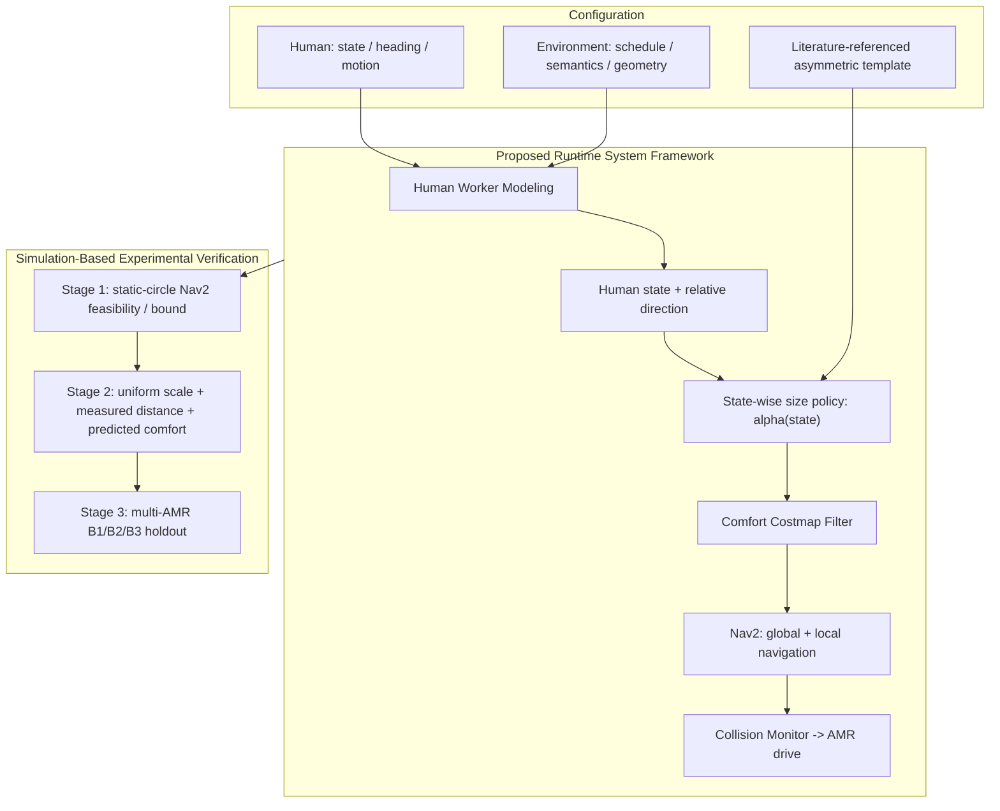
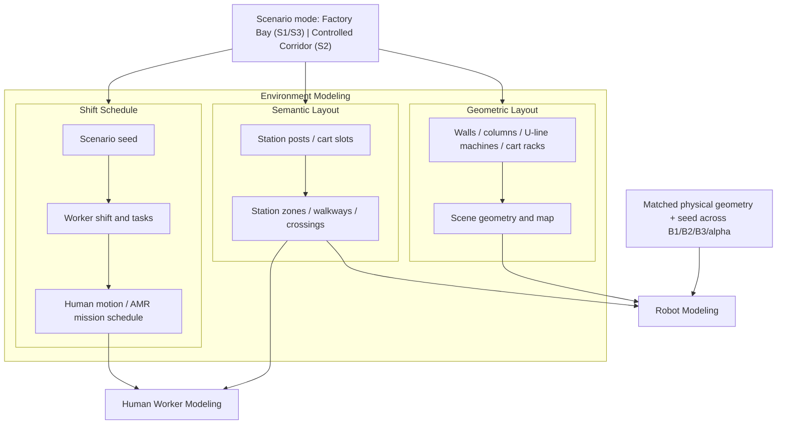
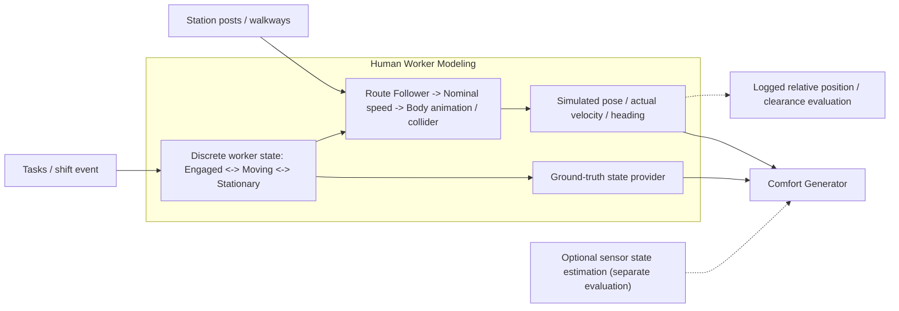
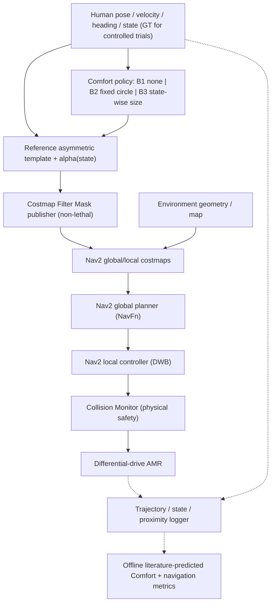

# Master-thesis 4-figure architecture — NAV2-only, framework-centric revision specification

**Status:** final **diagram AUTHORING SPECIFICATION** approved as the 2026-11-26 design target; not a claim that all new experiments are complete. Use together with [NAV2_ONLY_STAGE2_MAIN_EXPERIMENT_SPEC.md](NAV2_ONLY_STAGE2_MAIN_EXPERIMENT_SPEC.md). This document takes precedence over obsolete figure labels, old Yield-Gate architecture and old Stage 2 "real-world" plans, but never changes historical experimental data.

## 0. Central thesis contribution — must be visually unmistakable

> **Contribution:** A Digital Twin-based **system framework** that dynamically chooses an **operational SIZE** of a literature-referenced asymmetric Human Comfort Space based on worker state, integrates this space into the Nav2 costmap for multiple AMRs, and investigates the achievable balance between **literature-predicted human comfort** and **navigation performance / feasibility**.
>
> **NOT claimed:** invention of a new egg/ellipse/personal-space geometry; objectively measuring subjective comfort from a simulated human; proposing a custom low-level yielding / avoidance / backoff controller.

The research decomposes into (A) Environment Model + Worker Motion/State + AMR/Nav2/Comfort Costmap runtime; (B) Stage 1 **Navigation feasibility reference** (legacy static-circle upper 0.90m acquired WITH hold gate, must be **revalidated** under Nav2-only), Stage 2 **simulation-based uniform scale trade-off** (currently historical gate-assisted smoke only; new Nav2-only experiment pending), Stage 3 **new multi-AMR holdout** (pending Nav2-only, old gate-assisted result exists but is NOT this study's validation).

**Source audit:** User provided exactly four V1 PNGs in conversation: `전체 아키텍처 v1(1).png`, `Environment Modeling 아키텍처 v1(1).png`, `Human worker modeling 아키텍처 v1(1).png`, `Robot modeling 아키텍처 v1(1).png`. These are **NOT known to be present as image binaries on GitHub**; give them to the drawing agent separately if visual matching is needed. This document transcribes their content and supersedes incorrect blocks; do NOT assume the image files are in this repo.

## 1. Global notation and experimental truth

| Element | Figure label to use | Actual basis / limit |
|---|---|---|
| Human state | Moving / Stationary / Station Engaged | Scripted states + ground-truth provider in current controlled experiments |
| Heading | Velocity heading (moving); body facing (stationary, engaged) | Used to orient the reference geometry |
| Comfort shape | **Reference Asymmetric Shape** (not Proposed Novel Shape) | Existing engineering ratios motivated by Neggers/Gorrini; shape ratios not human-calibrated |
| Uniform size control | **State-wise Scale Selection** `alpha_H` | Stage 2 chooses one alpha **per state**, multiplies F/S/R identically; no independent axis tuning |
| Comfort evaluation | **Literature-based Predicted Comfort (OFFLINE)** | From measured actual closest center-to-center distance/bearing using `comfort_core/comfort_reference.py`; NEVER a feedback signal fed into Nav2 online |
| Human data stream | **Simulated Human Pose, Heading & State (Ground Truth in Controlled Runs)** | `perception.source=tf`, `humans.state_source=ground_truth` defaults; LiDAR worker classification is a separate optional capability |
| AMR movement | **Nav2 Global Planner / Local Controller** | NavFn/DWB (verify current params), no self-authored velocity from courtesy algorithms |
| Physical safety | **Nav2 Collision Monitor → AMR Drive** | Must remain active. Distinguish it from a prohibited `Yield Gate` |
| Comparators | B1 no Comfort / B2 static circle / B3 state-wise adaptive space | B3 geometry is referenced; innovation is policy/scale/validation framework |
| Number of agents | Stage 2: **1 human + 1 AMR**; Stage 1/3 factory: **8 humans + 3 AMRs** | Do not depict `AMR ×3` as the configuration of Stage 2 calibration |
| Sources of claims | completed vs pending | Historical 0.90m, old Gate-enabled; new results have not yet been established |

**Scope of safety claim:** say "physical collision-monitor safety layer retained", not "certified by ISO" or "guaranteed collision-free". If human–AMR contact occurs, report it as failure.

## 2. Figure 1 / OVERALL ARCHITECTURE

**Working title:** `Overall Architecture of the Proposed Comfort-aware Multi-AMR System Framework`.
**Function:** one glance communicates **(1) three modeling subsystems, (2) the operational state-dependent scale decision, (3) the THREE simulation experiment stages** and what each establishes. It should NOT imply that a novel ellipse, custom avoidance controller or real-world comfort survey is proposed.

**Revisions from V1 (image with vertical left rail "Configuration / System Modeling / Simulation Experiment"):**
- Keep the three-level logic as a clear stack with consistent arrows, but avoid unreadable dark-on-black text/transparent backgrounds and cramped connectors.
- In Configuration, `Adaptive Comfort Space` should be labeled `Reference Shape + State-wise Scale Policy`. `Human State` must remain three states, reference `Front/Side/Rear` ratio; the AMR arrow is a **relative direction measurement**, not the new shape's intellectual property.
- Environment + Human Worker + Robot Modeling correspond to Figs 2–4. Show the **runtime route** (state/heading → policy/shape → costmap mask → Nav2 → collision monitor) at least once, with no Yield Gate.
- Stage 1: `Static-Circle Feasibility Sweep (Simulation)` → `Navigation Upper Bound / Reference`, **revalidation required under the new Nav2-only condition**. Old 0.90m shown as `legacy reference (Gate-assisted)` if a number is printed; **do not show 0.90m as the verified Nav2-only upper** before rerun.
- Stage 2: replace V1's `Human Comfort · Real World`, `Human Passing Experiment`, `Comfort Rating Analysis`, `Comfort Lower Bound` with **`State-wise Uniform Scale Sweep (Simulation)`**, `Actual Distance & Navigation Metrics`, `Literature-predicted Comfort`, `Feasible Operational Scale / Unidentified`. Stage 2 is NO human-participant real-world test.
- Stage 3: `Multi-AMR Holdout: B1 / B2 / B3` → `Nav2-only completion, contact, no-progress, clearance & predicted comfort` → `Framework Performance Validation`. Replace `Validated Comfort Space` (overclaim).
- Separate the arrows: Stage1 reference → Stage2 template normalization; Stage2 state-wise alpha policy → Stage3 application. "No threshold observed" is allowed outcome.
- Core contribution should be a subtle caption or central output: `Systematic state-wise size selection and multi-AMR operational verification`.

**Source sketch — editable Mermaid to regenerate, redesign visually as vector:**

**Caption to use** (adjust only after new tests): "Figure X. Overall architecture of the proposed state-dependent Comfort Space sizing and Nav2-based multi-AMR verification framework; Stage 2 comfort values are literature-based predictions from simulated passing trajectories."

## 3. Figure 2 / ENVIRONMENT MODELING

**Working title:** `Environment Modeling for Factory-Bay and Controlled Passing Scenarios`.
**Retain from V1:** three modules `Shift Schedule`, `Semantic Layout`, `Geometric Layout`. Examples `Scenario Seed → Shift Exchange → Task List`; `Station Posts / Cart Slots / Aisles & Crossings → Station and Walkway Semantics`; `Walls & Columns / U-Line Conveyor & Machines / Cart Racks → Scene Geometry`.

**Corrections:**
- Do not confuse actual **factory-bay 24×16m / nominal 1.5m aisle** with Stage 2 single-human controlled corridor **width varying over pilot candidates**. Add explicit `Scenario Mode:` `Factory Multi-AMR (Stage 1/3)` vs `Controlled Corridor (Stage 2)` choice before configuration is frozen.
- Task schedule and seed determine **mission starts, work/departure/arrival events, human route schedule**, not their subjective comfort. Static physical geometry determines `Occupancy/SLAM Map` input and collision obstacles; semantic layout provides `work spots / station zones / walkway regions` to the scenario and optional state estimator.
- Connections: Schedule + semantic regions → Human Worker Modeling; geometry + semantic aisle/drivable regions → Robot/Nav2 Model; deterministic seed + policy comparisons → same environment freeze. **Do not draw physical interaction arrows from Scene Geometry to workers directly** unless they are motion constraints.
- Replace truncated labels `Aisles & Crossing s`, `Walls & Colum ns`, `U-Belt & Mach ines` with `Aisles & Crossings`, `Walls & Columns`, `U-Line Machines`; use enough width and no font reduction under print legibility.
- Include `Fixed Geometry Across Policy Conditions` as the reproducibility control. Environment may differ BETWEEN preregistered contexts, never BETWEEN alpha conditions of one context.

**Source sketch:**

**Caption:** "Figure X. Factory-bay scheduling, semantic regions, and geometric assets used to instantiate matched human and robot scenarios for the simulation experiments."

## 4. Figure 3 / HUMAN WORKER MODELING

**Working title:** `Worker State and Motion Modeling`.
**Retain from V1:** Engaged ↔ Moving via `depart/arrive`; Moving ↔ Stationary via `stop/resume`. Motion pipeline `Route Follower → Speed Profile → Body Animation & Collider`.

**Corrections:**
- `Human State` in **controlled main B1/B2/B3** comes from **scripted/ground truth state**, not a robot sensory state classifier. State inference may be shown as a dashed `Optional: Sensor-based State Estimator (separately evaluated)`, but is not a demonstrated cause of the main results.
- Motion follows prerecorded scenario seed/route (pedestrian **does not proactively avoid robot**, `avoid_robot:false`). Robot proximity (approach/clearance) is a **measured relationship**, not feedback that commands humans to dodge.
- `Moving` uses measured walking direction for heading; `Stationary` and `Station Engaged` use body facing. Explain engaged is **station-attached simulated state / idle animation**, not observation of actual industrial task activity; not a validated human psychology distinction.
- Display `Simulated Pose (x,y)`, `Actual Velocity`, `Body Heading`, `Discrete State` as outputs to `Comfort Space Generator`; if you show `LiDAR/SLAM` sensing the person, annotate optional or separate sensor evaluation.
- Input arrows: `Shift / tasks` → state transitions, `Station/Walkway` → motion route; \(x,y,v\) from actual animation/tick log.
- Keep speed/profile labels honest: human animation engine may not realize the requested nominal speed exactly; log **realized** speed, do not claim calibrated commanded-speed following.

**Source sketch:**

**Caption:** "Figure X. Simulation-defined worker states, state-transition events, and scripted motion; controlled policy comparisons use ground-truth state and measured pose/heading."

## 5. Figure 4 / ROBOT MODELING (highest priority)

**Working title:** `Comfort Space Integration with Nav2-Based AMR Navigation`.
**Must visually emphasize:** the contribution is **State-aware Operational Size Selection → Comfort Costmap → Nav2**, NOT `Yield Gate`, `Sidestep`, `Backoff`, or new ellipse method.

**Retain from V1**: `Perception / State Interface`, `Comfort Space Generator`, `Comfort-aware Navigation`, **AMR ×3** as factory mode and 1 AMR for Stage 2.

**Mandatory corrections:**
1. Remove `Yield Gate` entirely from the diagram and all `hold regions` as control outputs. `Collision Monitor` stays, clearly labeled **physical safety**. Exactly one movement-command chain per robot: `Nav2 Planner → Nav2 Local Controller → Collision Monitor → Differential Drive`. Nav2 native behavior-server recovery is still part of Nav2; it is not a separately authored human-social algorithm.
2. Comfort Generator:
   - B1 `None`, B2 `Static Circle (R_ref)`, B3 `Literature-referenced Offset Ellipse + State-wise alpha(H)`.
   - `State + relative bearing + heading` select policy orientation, F/S/R remain a **fixed shape ratio within a state**; Stage 2 sweeps a SINGLE `alpha` at a time, final B3 uses one selected per state.
   - Output `analytic high non-lethal Comfort Costmap Filter Mask`, with fixed soft band (`buffer_width=0.10m`) into **Nav2 Global + Local Costmap**. Do not draw Comfort shape as a lethal collider or a new physical safety zone. The actual planner mask accounts for AMR footprint, separate from comfort geometry.
3. Perception:
   - `LiDAR / SLAM + map` supports localization/physical geometry; **main controlled experiment's human state and pose is simulation ground truth**. If a visual `Worker Tracking / State Classifier` module remains, mark it as **Optional sensor-mode evaluation**, not an experimentally proven controller input in the current main B1/B2/B3.
4. Inputs: Environment map / station zones, person state and pose/velocity/heading, offline-selected state alpha. Human–AMR approach direction is computed for model orientation/measurement; no robot-to-human movement control.
5. Outputs: actual robot pose/path, nav success/abort, physical contact / monitor stops, closest clearance and running time. **Predicted Comfort Evaluator is an independent post-processing block**, consuming trajectory log + Neggers reference curve, not influencing controller at runtime. Avoid `Comfort Rating Analysis` (no simulated questionnaires).
6. `AMR ×3 (Stage 1/3)`, `AMR ×1 (Stage 2)`; each Nav2 namespace independently, shared environment/human reference mask where applicable, no AMR1-only human-social motor gate.
7. Use consistent role names: `Comfort Policy Selector`, `Reference Shape & State-wise Scale`, `Mask Publisher`, `Nav2 Global/Local Costmap`, `Nav2 Global Planner`, `Nav2 Local Controller`, `Collision Monitor [Physical Safety]`, `AMR Differential Drive`.

**Source sketch:**

**Caption:** "Figure X. State-dependent reference-space sizing and its integration into each AMR's Nav2 costmap, planning, control and independent collision-monitor safety chain. Human comfort is evaluated offline from actual simulated trajectories."

## 6. Diagram consistency, publication format and review checks

- Four deliverables, **not four completely different competing frameworks**: Fig 1 overall; Fig 2 Environment detail; Fig 3 Worker detail; Fig 4 Robot detail. Shared labels and same directions on all arrows. Fig 1 aggregates Figs 2–4.
- Use a calm high-contrast **white/very light background**, black readable text and one muted accent color for the proposed **state-wise size policy**, grey for standard infrastructure; colored shapes do not imply methodological novelty.
- English labels for use in a master's thesis, consistent capitalization, short terms, no broken wraps (`Costmap L ayer`, `Hold Regio ns`, `Crossing s` must disappear), arrowheads never overlap text; no dark-on-black title. Provide grayscale-print compatibility, academic figure numbers/captions, generous whitespace and 16:9 or thesis-column-appropriate variants.
- Clearly distinguish **solid arrows = data/command**, **dashed = logging/measurement/offline reference**; avoid calling physical proximity "measured physical interaction" if humans are scripted not reactive.
- Stage 2 is **Simulation-based**; no `Real World`, `Human Passing Experiment`, `Comfort Rating`, `Validated Comfort Space`, `ISO-certified comfort` labels.
- Current program uses ground truth in controlled trials. Do not depict LiDAR-based state classification as a tested live input unless a specific separate trial supports it. Sensor estimation is future/optional not a main contribution claim without validation.
- The exact user request: **no separate custom yielding, moving sidestep, backoff, off-lane recovery, or gate-generated cmd_vel** in the **new** Nav2-only experiment; retain physics Collision Monitor. If code is not yet switched, label the diagram "target architecture — new validation pending", do not imply it already ran.
- Human motion and scenario seed are **condition invariant** within each matched experiment. No dynamic robot-aware pedestrian avoidance; no real human rating measured.
- B1/B2/B3 must use identical Nav2 + safety settings; only Comfort Space policy/scale differs. The confidence caveat from old Stage 3 applies: same seed does not guarantee same simulation outcome.

**Expected Claude output:** editable source (`docs/figures/architecture_nav2_only_v2/*.mmd` or vector illustration source), `Overall_Framework_v2.svg/png`, `Environment_Modeling_v2.svg/png`, `Human_Worker_Modeling_v2.svg/png`, `Robot_Modeling_v2.svg/png`, a figure-to-code consistency table, captions and a change log comparing all four V1 user images. Prefer true editable vector outputs where possible; do not rasterize tiny unreadable text. If Mermaid sketches are too dense, use a design tool and keep the named nodes/arrows exactly faithful to this document. Validate by opening/rendering all four figures at full view and at thesis column width.

**Integration with manuscript:** The thesis' objective is an **operational system framework**, not shape discovery or human experiment. Keep the figure names, system-flow wording, and new Stage 2/3 claims consistent with [NAV2_ONLY_STAGE2_MAIN_EXPERIMENT_SPEC.md](NAV2_ONLY_STAGE2_MAIN_EXPERIMENT_SPEC.md).
