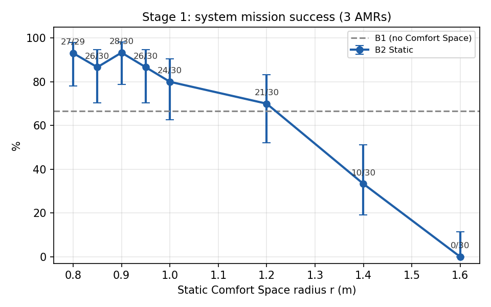
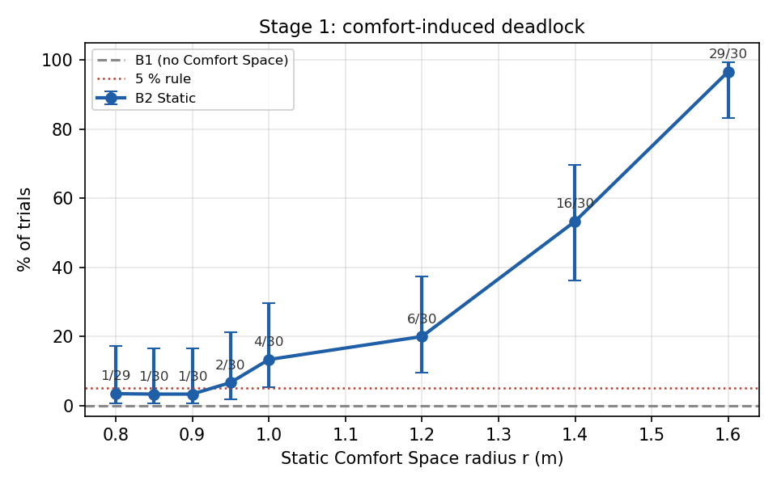
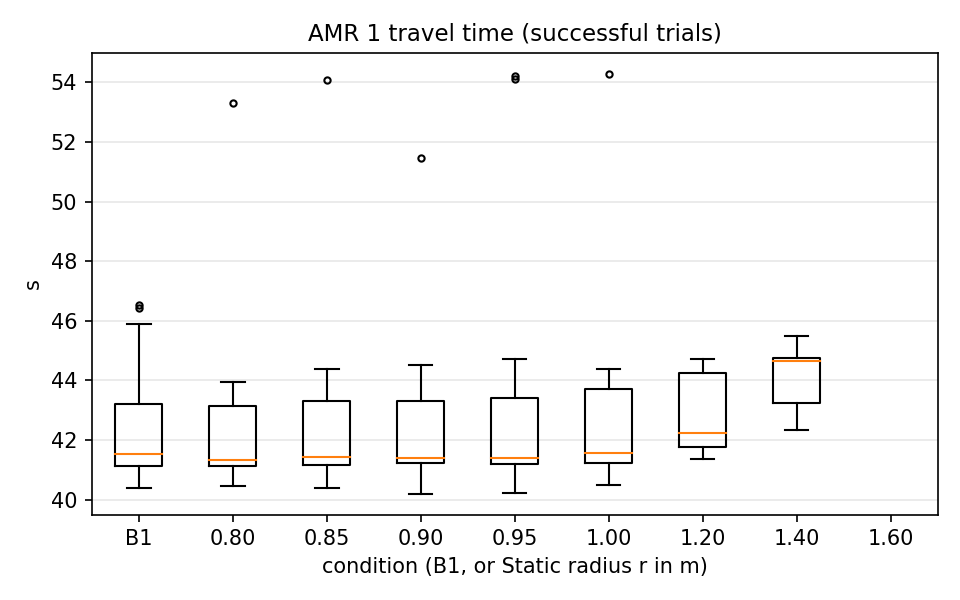
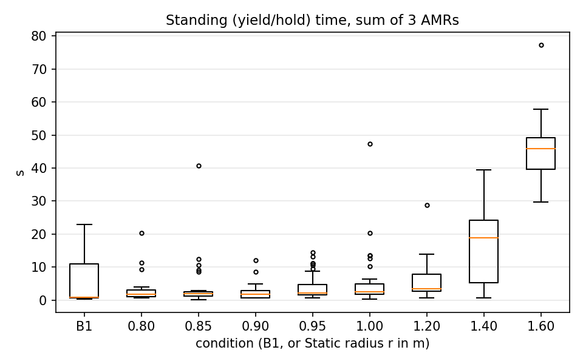
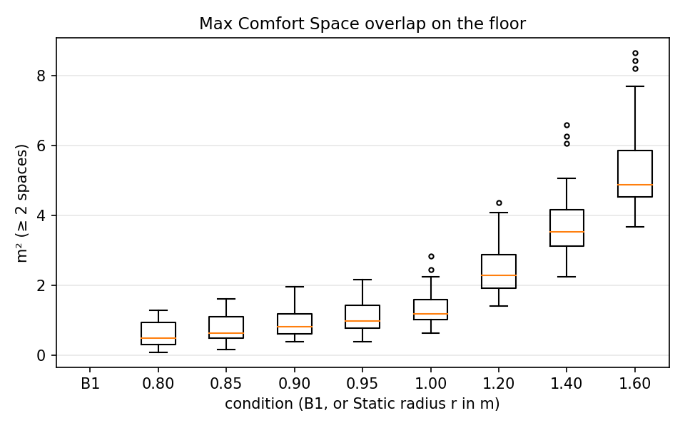
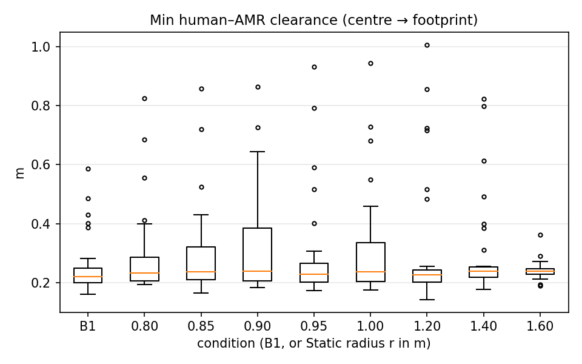
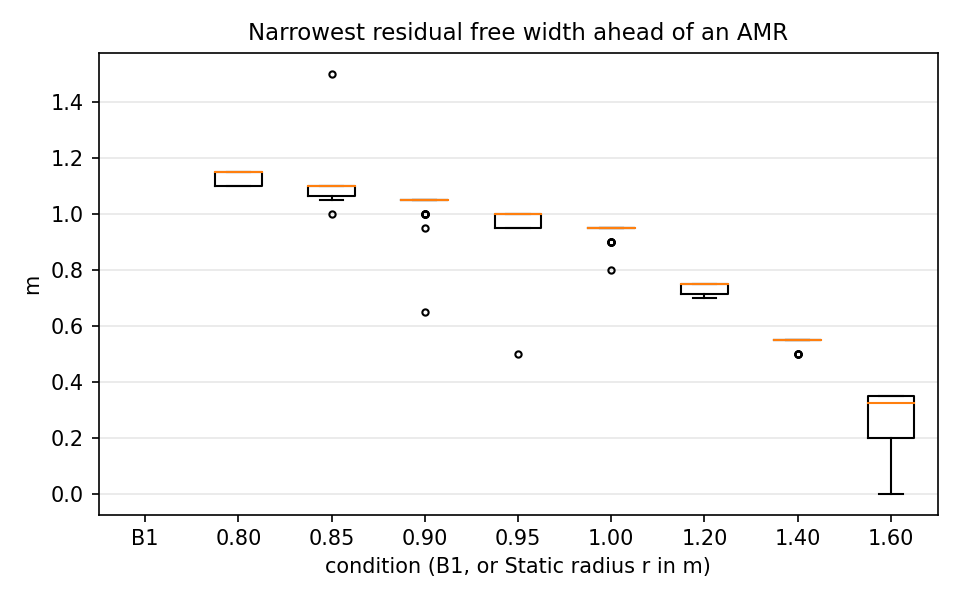

# Stage 1 (final) — Navigation Upper Bound, B2 Static size sweep

> Cross scenario (8 people, AMR 1/2/3), frozen navigation (buffer 0.10 m), every AMR on Nav2 only. Seeds 1–30 (30 seeds; reduced from the planned 100 by user decision 2026-11-25), same seed = same people / missions / timing; only the Comfort Space differs. Rates are count / n with a Wilson 95 % CI.

## Summary

| condition | n | system success | comfort-induced deadlock | same, B1-success seeds | all-cause failure | B1 same seeds | AMR1 / a1 / a2 success | AMR1 travel s (median, success) | hold s / trial (median) | min human–AMR m (median) | overlap m² (median max) | residual width m (median min) |
|---|---|---|---|---|---|---|---|---|---|---|---|---|
| B1 | 30 | 20/30 (67%, 49–81) | 0/30 (0%, 0–11) | 0/20 (0%, 0–16) | 10/30 (33%, 19–51) | 20/30 (67%, 49–81) | 25 / 30 / 25 of 30 | 41.53 | 0.93 | 0.221 | None | None |
| B2_r080 | 29 | 27/29 (93%, 78–98) | 1/29 (3%, 1–17) | 0/19 (0%, 0–17) | 2/29 (7%, 2–22) | 19/29 (66%, 47–80) | 29 / 29 / 27 of 29 | 41.32 | 1.82 | 0.232 | 0.483 | 1.15 |
| B2_r085 | 30 | 26/30 (87%, 70–95) | 1/30 (3%, 1–17) | 1/20 (5%, 1–24) | 4/30 (13%, 5–30) | 20/30 (67%, 49–81) | 29 / 29 / 27 of 30 | 41.42 | 2.05 | 0.236 | 0.625 | 1.1 |
| B2_r090 | 30 | 28/30 (93%, 79–98) | 1/30 (3%, 1–17) | 1/20 (5%, 1–24) | 2/30 (7%, 2–21) | 20/30 (67%, 49–81) | 30 / 30 / 28 of 30 | 41.39 | 1.84 | 0.239 | 0.804 | 1.05 |
| B2_r095 | 30 | 26/30 (87%, 70–95) | 2/30 (7%, 2–21) | 2/20 (10%, 3–30) | 4/30 (13%, 5–30) | 20/30 (67%, 49–81) | 30 / 30 / 26 of 30 | 41.41 | 2.23 | 0.23 | 0.972 | 1.0 |
| B2_r100 | 30 | 24/30 (80%, 63–90) | 4/30 (13%, 5–30) | 3/20 (15%, 5–36) | 6/30 (20%, 10–37) | 20/30 (67%, 49–81) | 29 / 29 / 25 of 30 | 41.55 | 2.52 | 0.236 | 1.177 | 0.95 |
| B2_r120 | 30 | 21/30 (70%, 52–83) | 6/30 (20%, 10–37) | 5/20 (25%, 11–47) | 9/30 (30%, 17–48) | 20/30 (67%, 49–81) | 29 / 28 / 23 of 30 | 42.23 | 3.355 | 0.226 | 2.273 | 0.75 |
| B2_r140 | 30 | 10/30 (33%, 19–51) | 16/30 (53%, 36–70) | 13/20 (65%, 43–82) | 20/30 (67%, 49–81) | 20/30 (67%, 49–81) | 14 / 30 / 21 of 30 | 44.64 | 18.945 | 0.238 | 3.534 | 0.55 |
| B2_r160 | 30 | 0/30 (0%, 0–11) | 29/30 (97%, 83–99) | 19/20 (95%, 76–99) | 30/30 (100%, 89–100) | 20/30 (67%, 49–81) | 0 / 29 / 13 of 30 | None | 45.96 | 0.239 | 4.885 | 0.325 |

## Failure classes (per AMR, all trials)

| condition | COMFORT_OVERLAP_BLOCK | HUMAN_MOTION_BLOCK | NAV2_ABORT | NORMAL_YIELD | PERSISTENT_COMFORT_HOLD | PROTECTIVE_STOP | ROBOT_ROBOT_BLOCK | SINGLE_HUMAN_COMFORT_BLOCK | SUCCESS | TEMPORARY_HOLD | UNKNOWN |
|---|---|---|---|---|---|---|---|---|---|---|---|
| B1 | 0 | 2 | 6 | 2 | 0 | 2 | 0 | 0 | 78 | 0 | 0 |
| B2_r080 | 0 | 0 | 0 | 22 | 0 | 0 | 0 | 1 | 63 | 0 | 1 |
| B2_r085 | 0 | 2 | 0 | 23 | 0 | 1 | 1 | 1 | 62 | 0 | 0 |
| B2_r090 | 0 | 0 | 1 | 27 | 0 | 0 | 0 | 1 | 61 | 0 | 0 |
| B2_r095 | 0 | 1 | 1 | 27 | 0 | 0 | 0 | 2 | 58 | 1 | 0 |
| B2_r100 | 0 | 0 | 0 | 24 | 0 | 3 | 0 | 4 | 59 | 0 | 0 |
| B2_r120 | 0 | 0 | 2 | 29 | 1 | 0 | 0 | 5 | 51 | 0 | 2 |
| B2_r140 | 0 | 5 | 1 | 25 | 0 | 0 | 0 | 19 | 40 | 0 | 0 |
| B2_r160 | 11 | 4 | 0 | 39 | 3 | 1 | 0 | 29 | 1 | 2 | 0 |

## Decision (pre-registered rule)

- rule: transition = first size with comfort-induced deadlock rate > 5 % (5/100; 1/30 at 30 seeds); R_nav_upper = largest size with comfort-induced deadlock rate <= 5 % and system success >= same-seed B1 - 5 %p
- transition size: 0.95
- fine-search interval: [0.9, 0.95]
- **R_nav_upper = 0.9 m**
- operational upper bound of THIS scenario and navigation stack; not a mathematical maximum and not a comfort distance.

## Figures

