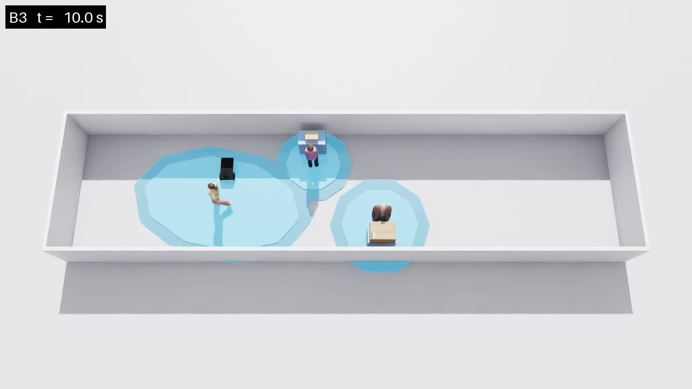
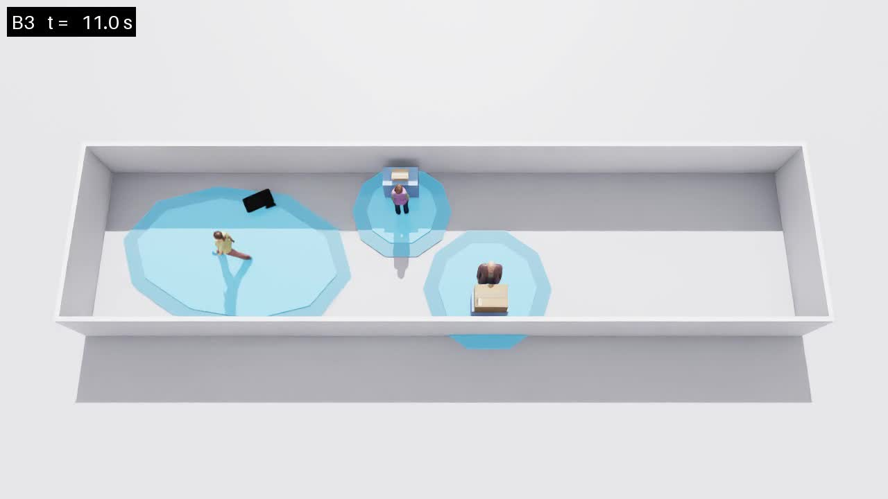
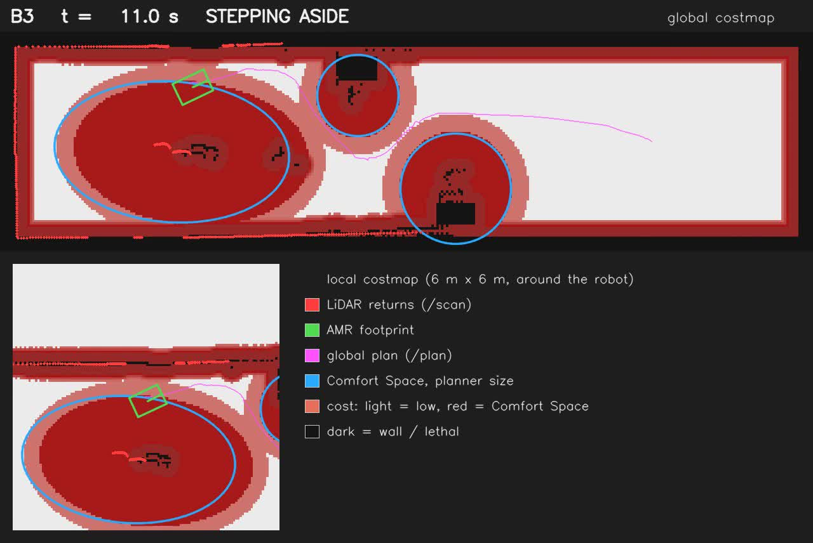
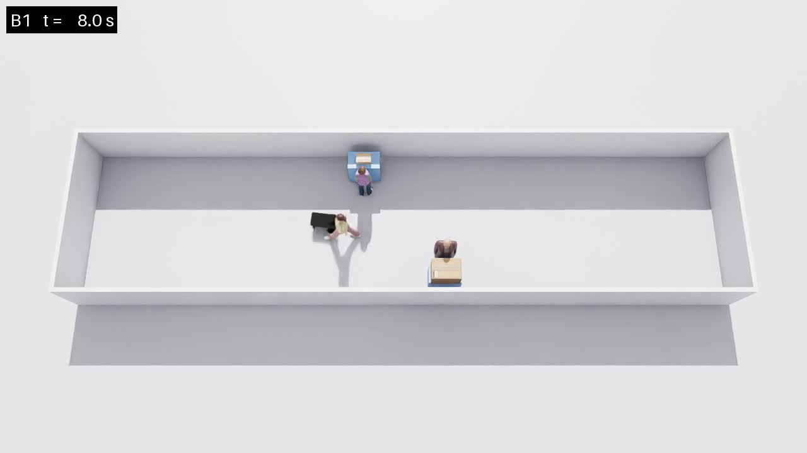
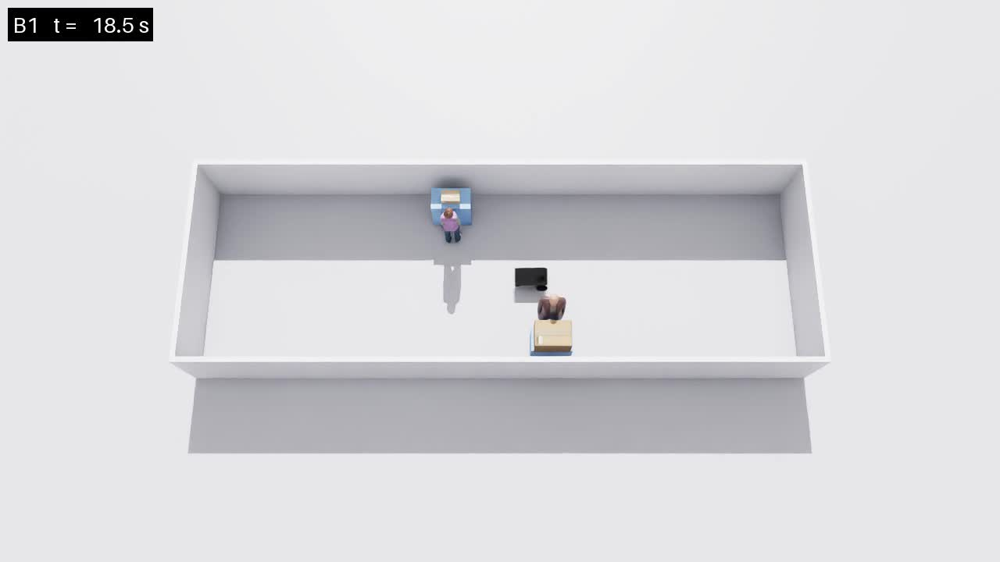

# 260920 Comfort_AMR · B1 시나리오 & Comfort Space 고려 양보

**오늘 한 일**
1. **B1 시나리오**: Comfort Space가 없는 기준선을 추가했다. 사람은 LiDAR에 보이는 장애물일 뿐이다.
2. **양보 개선**: 걸어오는 사람에게 비켜설 때 몸만 피하던 것을, 그 사람의 Comfort Space를 최대한 침범하지 않는 자리에서 기다리도록 바꿨다.

**핵심 결과**: B1은 걷는 사람과 부딪혔다. B3의 비켜서기는 걷는 사람 Comfort Space 침범을 0.64 m에서 0~0.28 m로 줄였다.

---

## 1. B1 시나리오: Comfort Space 없음

| | B1 | B2 | B3 |
|---|---|---|---|
| Comfort Space | 없음 | 모두 1.20 m | 상태별 0.60 / 0.90 / 1.20 m |
| 양보 게이트 | 꺼짐 | 켜짐 | 켜짐 |
| Collision Monitor | 켜짐 | 켜짐 | 켜짐 |
| 사람을 보는 방식 | LiDAR 장애물만 | LiDAR + Comfort Space | LiDAR + Comfort Space |

- 설정 파일은 `configs/scenario_b1.yaml` 하나이고, B2·B3와 Comfort Space 항목만 다르다.
- 걷는 사람에게 비켜서는 동작도 양보 게이트 안에 있어서 B1에서는 함께 꺼진다.

### 공통 평가 기준 추가
B1은 Comfort Space가 없어서 "얼마나 침범했나"를 잴 기준이 없다. 그래서 **모든 시나리오를 B3의 Comfort Space로 잰다.** 같은 잣대라야 세 시나리오를 비교할 수 있다.

- **침범 깊이**: 로봇 몸체가 사람의 Comfort Space 안으로 들어간 최대 거리
- **침범 시간**: 몸체 일부라도 안에 있었던 시간
- **최소 틈**: 로봇 외곽과 사람 몸 사이의 물리적 거리. 0 이하는 충돌

---

## 2. 양보 개선: 걸어오는 사람의 Comfort Space를 고려한 비켜서기

### 문제
기존(v1)은 걸어오는 사람과 몸이 닿지 않을 만큼만 비켰다. 몸은 안전했지만 로봇이 걷는 사람의 Comfort Space 한가운데에 서 있었다.

| v1 B3 + 걷는 사람 | 값 |
|---|---|
| 침범 깊이 | 0.64 m |
| 침범 시간 | 3.9 s |

### 방법
1. **예측**: 걷는 사람의 Comfort Space 타원을 현재 속도와 방향으로 앞으로 연장해, 앞으로 지나갈 영역을 만든다.
2. **시작 조건**: 이 예측 영역이 10초 안에 로봇 몸체에 닿으면 대응을 시작한다. 몸이 부딪힐 때가 아니라 공간이 닿을 때다.
3. **후보 자리**: 복도 가로 방향 0.1 m 간격과 뒤쪽 0.5 m까지 후보를 만든다. 벽·Station·다른 사람과 닿는 자리는 뺀다.
4. **점수**: 각 후보에서 기다리는 동안 걷는 사람과 서 있는 사람들의 Comfort Space 침범량을 계산해 가장 적은 곳을 고른다. 진행선을 건너야 하는 자리는 사람이 오기 전에 건널 수 있을 때만 인정한다.
5. **자세**: 복도와 나란히, 목표 방향을 보고 선다. 옆으로 차지하는 폭이 가장 작다.
6. **재확인**: 사람이 가까워질수록 추정이 정확해지므로 0.5초마다 더 나은 자리를 찾는다. 고른 쪽은 바꾸지 않는다. 자리가 진행선에 너무 가까워지면 즉시 몸만 피하는 방식으로 넘어간다.
7. **인계**: 사람이 지나가면 목표 방향으로 완전히 돈 뒤 Nav2에 제어를 돌려준다.

### 개발 중 발견한 문제와 해결
| 문제 | 원인 | 해결 |
|---|---|---|
| 좌우를 바꾸다 진행선을 가로질러 충돌 (오프라인 108회 중 36회) | 멀리서의 방향 오차로 예측 영역이 흔들림 | 한번 고른 쪽 고정 |
| 진행선 안쪽 자리를 고름 | 걷기 시작 직후 0.3초 데이터로 방향 추정 | 1초 구간이 찰 때까지 속도·방향을 쓰지 않음 |
| 11 m 앞 진행선이 0.6 m 틀어짐 | 방향 3° 오차 × 거리 | 복도 축과 15° 이내면 복도 방향으로 걷는다고 가정 |
| 인계 후 벽에 붙어 교착 | 벽 5 cm 앞에서 대기, 반쯤 돈 상태로 인계 | 벽과 회전 가능한 거리 유지, 다 돈 뒤 인계 |

### 결과

**오프라인 테스트 108회** (보행 속도 1.0~1.4 m/s, 좌우 흔들림, 위치 잡음 2 cm)

| | v1 몸만 피하기 | v2 Comfort Space 고려 |
|---|---|---|
| 침범 깊이 중앙값 | 0.40 m | 0.00 m |
| 전혀 침범하지 않은 경우 | 5회 | 70회 |
| 충돌 | 0회 | 0회 |

**Isaac Sim, B3 + 걷는 사람**

| | v1 (1회) | v2 (5회) |
|---|---|---|
| 침범 깊이 | 0.64 m | 0.00 ~ 0.28 m |
| 침범 시간 | 3.9 s | 0 ~ 1.7 s |
| 걷는 사람과 최소 틈 | 0.33 m | 0.74 ~ 1.03 m |
| 주행 시간 | 35.8 s | 38.4 ~ 40.0 s |
| 결과 | 성공 | 5회 모두 성공 |

대가로 주행이 약 3~4초 길어졌다. 벽 쪽으로 더 멀리 가서 기다리기 때문이다.

### 시도했다가 끈 것: 예측 영역을 Nav2 costmap에 칠하기
같은 예측 영역을 costmap에 미리 칠해서 Nav2가 일찍 비켜 가게 하려 했다. 3회 중 1회 충돌, 1회 교착으로 오히려 나빠져 기본값을 껐다(`comfort_space.costmap.predict.enabled: false`).

**원인**: costmap에는 시간 축이 없다. 사람이 몇 초 뒤 지날 자리를 전부 지금 막힌 것으로 칠하게 된다. 그 결과 Nav2는 아래쪽 벽 경로를, 게이트는 위쪽 벽 대기를 골라 서로 충돌했다. 예측은 시간 정보를 가진 게이트에서 쓰는 것이 맞다.

---

## 3. 전체 시나리오 결과 (v2 녹화 실행)

| 시나리오 | 결과 | 주행 시간 | 걷는 사람 최소 틈 | 걷는 사람 침범 | 서 있는 사람 침범 |
|---|---|---|---|---|---|
| B1 | 성공 | 29.6 s | - | - | b에 0.19 m, 4.6 s |
| B2 | 교착 | 30.4 s | - | - | 없음 |
| B3 | 성공 | 26.6 s | - | - | 없음 |
| B1 + 걷는 사람 | 성공 | 26.8 s | **-0.08 m, 0.8 s 충돌** | 1.93 m, 3.6 s | a 0.06 m, b 0.11 m |
| B2 + 걷는 사람 | 교착 | 39.8 s | +0.76 m | 0.19 m, 2.2 s | 없음 |
| B3 + 걷는 사람 | 성공 | 38.4 s | +0.74 m | 0.28 m, 1.7 s | 없음 |

침범량은 모두 B3 Comfort Space 기준이다. B1 + 걷는 사람은 세 번 중 두 번 충돌했고, 한 번은 0.07 m 차이로 스쳤다.

> 📹 영상과 costmap GIF: `results/videos/v2_comfort_aware_yield/<시나리오>/<조건>/`
> - 시나리오: `b1_no_comfort_space`, `b2_static`, `b3_state_adaptive`
> - 조건: `standing_only`, `with_walker`
> - 파일: `*_camera.mp4`, `*_costmap.mp4`, `*_costmap.gif`, `*_costmap_small.gif` (노션용 5 MB 이하)
> - 이전 동작 영상은 `results/videos/v1_physical_sidestep/`

---

## 4. 다음 단계
- **B1 위험성 보여주기**: 공유 환경을 바꾸기보다 걷는 사람 조건을 반복 실행해 충돌률과 최소 틈 분포로 보여주는 방향
- **Comfort Space 크기 근거**: 현재 0.60 / 0.90 / 1.20 m는 임의값. 근접학(proxemics) 거리나 반지름 민감도 실험으로 근거 마련
- **주행 시간 손실**: v2가 v1보다 3~4초 느린 부분
- **반복 실험 자동화**: trial별 CSV 기록과 반복 실행 스크립트
