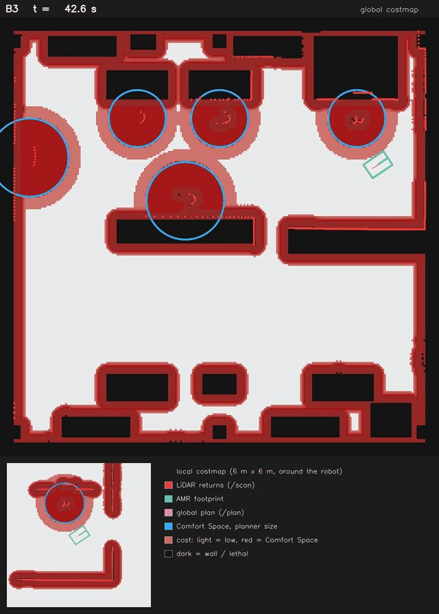
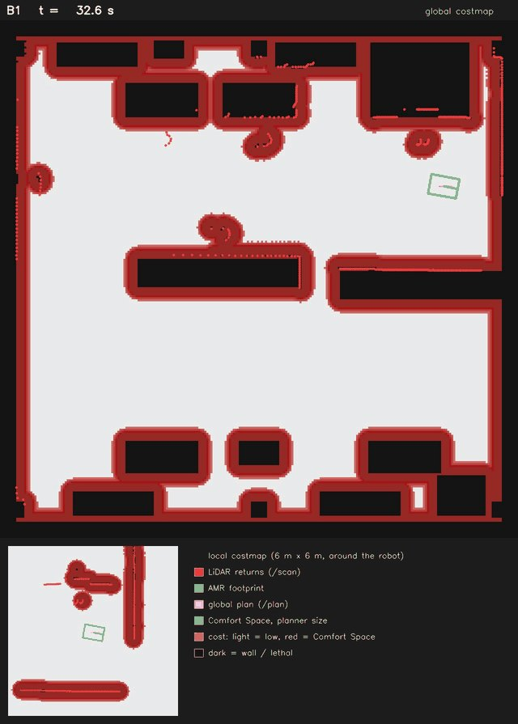

# 260926 Comfort_AMR · 공장 Scene에서 실험 돌리기

**오늘 한 일**: 만든 공장 베이에서 실제로 AMR이 Nav2로 주행하게 연결했다.
복도 Scene 코드는 그대로 두고, config 하나로 어느 Scene에서 돌릴지 정한다.

```bash
./scripts/run_b3.sh --headless --config configs/factory.yaml
```

---

## 1. 무엇을 바꿨나

| 바꾼 것 | 내용 |
|---|---|
| Scene 선택 | config에 `factory` 절이 있으면 복도 대신 베이를 만든다 |
| 사람 | 여전히 `humans` 항목. 콜라이더·Comfort Space·`/tf`·상태가 전부 거기서 나온다 |
| 기하 질의 | `corridor_bounds` → `scene_bounds`, `station_boxes` → `obstacle_boxes` |
| 맵 | `generate_map.py`가 베이도 그린다. Nav2 파라미터와 마스크가 자동으로 공장 맵을 고른다 |
| 검증 | 시작/목표가 통로 안인지, 사람이 설비나 대피 공간 안에 서 있지 않은지 빌드 때 확인 |

복도 쪽 동작은 건드리지 않았다. 복도 config에는 `factory` 절이 없어
전부 예전 경로를 탄다.

---

## 2. 1.5 m 통로에서 드러난 문제

첫 실행은 **교착**이었다. 13.7 m 중 3.3 m만 가고 멈췄다. 세 가지가 겹쳐 있었다.

### (1) 걷는 사람이 같은 통로를 왕복했다

복도(3.9 m)에서는 마주 오는 사람을 지나칠 수 있어서 왕복이 문제가 아니었다.
1.5 m 통로에서는 지나칠 수 없으므로, 사람이 돌아오면 로봇에게는 영영 틈이
없다. 공장 시나리오의 보행자는 **한 번만 통과**한다.

### (2) 로봇이 작업 구역에서 대기했다

맵상 작업 구역은 자유 공간이라 로봇이 라인 사이로 들어가 섰다. 사람이
일하는 자리다. 이제 대기 후보는 **통로와 대피 공간만**, 그리고 **가는 경로도
통로 위**여야 한다.

### (3) 대피 공간이 너무 멀었다

12 m 간격이면 가장 가까운 대피 공간이 2.5 m 떨어져 있다. 0.35 m/s로 가면
9.7초, 사람이 1 m/s로 오면 마감은 6.9초다. 제때 못 간다. 간격을 **6 m**로
줄이고 끝에서 1 m부터 두니 대피 공간이 시작 지점 바로 옆(0.55 m)에 생긴다.

---

## 3. 양보 로직에서 고친 것

| 고친 것 | 이유 |
|---|---|
| 대기 자리를 로봇 외곽선 기준으로 판정 | 외접원(0.42 m)으로 재면, 통로와 나란히 선 로봇이 실제로 내미는 0.24 m보다 0.18 m 더 비켜야 한다고 계산되어 들어갈 수 있는 대피 공간을 버렸다 |
| 가는 길도 통로 위여야 함 | 반대편 대피 공간이 점수는 제일 좋은데, 거기까지 작업 구역을 가로질러야 했다 |

복도 오프라인 108회로 회귀를 확인했다. 침범 깊이 중앙값 0.00 m, 충돌 0건,
대기 중 0이 아닌 명령 0건으로 이전과 같다.

> 중간에 "마감보다 늦게 도착하는 자리는 버린다"는 규칙도 넣어 봤는데,
> 복도에서 벽 쪽 좋은 자리를 버리고 가까운 자리를 고르게 되어 침범 중앙값이
> 0.00 → 0.09 m로 나빠졌다. 되돌렸다. 경로 조건만으로 충분했다.

---

## 4. 결과

> 아래 숫자는 설비를 상자로 그리고 통로가 순환로가 아니던 **이전 배치**에서 잰 것이다.
> 실제 모델과 순환 통로로 바꾼 뒤에는 다시 재야 한다.

공장 베이에서 세 시나리오를 한 번씩 돌렸다. 걷는 사람 1명, 설비 앞 작업자
4명, 북쪽 통로를 끝에서 끝까지 9.6 m 주행.

| 시나리오 | 결과 | 주행 | 걷는 사람과 최소 거리 | 침범 깊이 / 시간 | 접촉 |
|---|---|---|---|---|---|
| B1 (Comfort Space 없음) | 성공 | 29.4 s, 12.13 m | **-0.058 m** | 1.97 m / 4.4 s | 1.5 s |
| B2 (static 1.20) | 성공 | 55.1 s, 15.37 m | +1.170 m | 0.01 m / 0.1 s | 없음 |
| B3 (state-adaptive) | 성공 | 39.5 s, 13.55 m | +0.619 m | 0.52 m / 3.5 s | 없음 |

침범은 세 시나리오 모두 **B3 기준의 Comfort Space**로 잰다(같은 자).

읽는 법:

- **B1은 사람을 친다.** 가장 빠르지만 0.058 m만큼 파고들어 1.5초 접촉했다.
  Comfort Space가 없을 때 1.5 m 통로에서 일어나는 일이다.
- **B2는 가장 정중하고 가장 느리다.** 사람과 1.17 m를 유지했고 침범이 거의
  없다. 대신 B1보다 25.7초, B3보다 15.6초 더 걸렸다. 13.2초를 대기에 썼고
  경로도 1.8 m 더 돌았다.
- **B3은 중간이다.** 39.5초에 접촉 없이 도착했지만, 걷는 사람 옆을 0.62 m로
  지나가며 0.52 m 침범했다. 대피 공간 깊이가 0.9 m라 1.20 m 타원을 완전히
  벗어날 수 없기 때문이다.

복도(3.9 m)에서는 같은 반경(1.20)으로 B2가 교착이었다. 통로가 1.5 m로
좁아지고 대피 공간이 생기자 **B2도 통과한다. 대신 시간으로 지불한다.**
반경은 복도와 같은 값을 그대로 썼다. 좁은 통로에서 정책 차이가 성공/실패가
아니라 시간과 거리의 교환으로 나타난다는 것이 이 Scene의 결과다.

> 통로 폭 계산에서 1.20 m는 "편한 틈이 없다"고 나온다. 그래도 통과하는 이유는
> Comfort Space가 costmap에 유한한 비용(98)으로 들어가기 때문이다. 막는 것이
> 아니라 비싸게 만드는 모델이라는 점이 여기서 그대로 드러난다.





영상은 `results/videos/v5_factory_bay/<시나리오>/factory/`에 있다.

---

## 5. 남은 일

- 작업 구역을 Nav2 단계에서도 막기(정적 keepout 마스크). 지금은 양보 로직만
  통로를 지키고, 전역 경로는 작업 구역을 지나갈 수 있다.
- 복도에서 쓰던 조건들(standing_only 등)을 공장 버전으로도 정리.
- 반복 실행과 CSV 기록(`comfort_core/metrics.py`).
