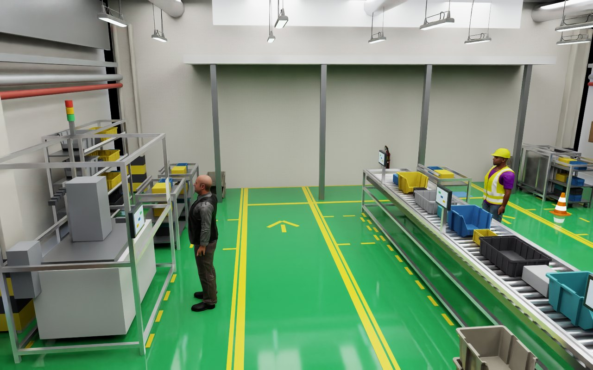
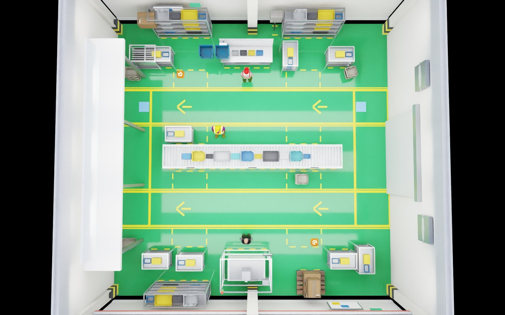
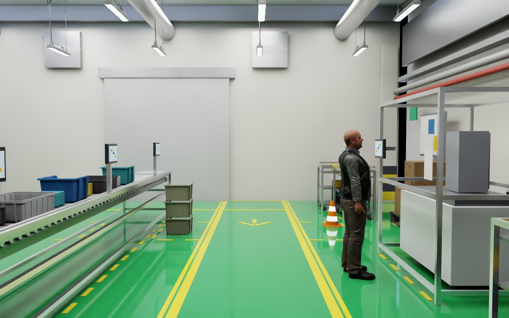
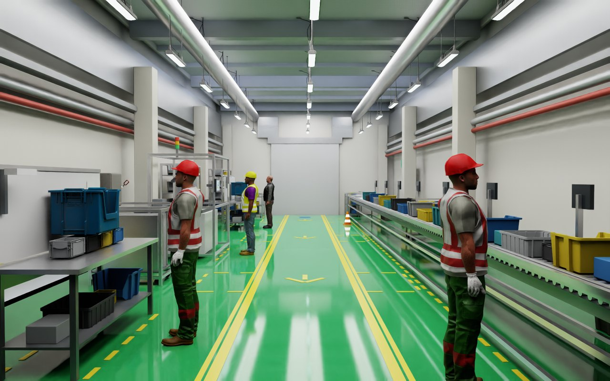

# 260926 Comfort_AMR · 현장형 공장 Scene 구축

**오늘 한 일**: 복도 Scene 옆에, 현장 레이아웃을 참고한 12 m × 12 m 공장 베이를
만들었다. 통로 1.5 m, 기둥 6 m 간격, 설비 14대, 작업자 8명. Isaac Sim에서 열어
직접 옮길 수 있고, 옮긴 결과를 config로 되돌릴 수 있다.

**핵심 결과**: 1.5 m 통로에서 Comfort Space 반경이 얼마까지 가능한지 숫자로
나왔다. 반경 1.20 m는 아무도 걷지 않아도 두 통로를 다 막는다.



---

## 1. 무엇을 만들었나

처음에는 전부 색칠한 상자로 그렸다. 치수 확인에는 충분했지만 레고처럼
보였고, LiDAR도 실제 설비가 아닌 직육면체를 봤다. 지금은 Isaac Sim 에셋
라이브러리의 실제 모델을 쓴다.

| 바뀐 것 | 내용 |
|---|---|
| 설비 | 작업대, 롤러 컨베이어, 팔레트 랙, 제어반, 카트 — 전부 실제 모델 |
| 셸 | 창고 벽 패널, H형 기둥, 콘크리트 바닥 타일 |
| 조명 | 창고 인테리어 HDRI. 벽 위로 건물 내부가 이어져 보인다 |
| 사람 | 실험에서 쓰는 것과 같은 애니메이션 캐릭터 |
| 소품 | 안전콘, 소화기, 크레이트, 적재 상자 |
| 통로 | 두 통로를 양 끝에서 잇는 가로 통로. 따로 노는 두 줄이 아니라 한 바퀴 도는 길 |

에셋 서버에 접속할 수 없으면 같은 치수의 상자로 자동 대체된다. 치수는
`equipment.modules`와 모델 실측값을 둘 다 적어 두고 빌드 때 대조하므로,
둘이 어긋나면 그 자리에서 실패한다.

| 구성 | 내용 |
|---|---|
| 셸 | 12 × 12 m 바닥, 벽 4면, 기둥 6개(6.0 m 간격) |
| 바닥 도색 | 베이 전체 에폭시(작업 구역 회녹색, 통로 진녹색), 노란 경계선과 대피공간 |
| 통로 | 1.5 m 두 줄(남·북) + 양 끝 가로 통로 2곳 = 순환로 |
| 조립 라인 | 컨베이어 3연장 8.2 m, 양쪽에서 작업 |
| 설비 | 작업대 2, 랙 4, 컨베이어 2, 기계 1, 제어반 1, 팔레트 1, 카트 1 |
| 작업자 | 설비 앞 6명, 각자 자기 설비를 바라봄 |
| 대피 공간 | 1.5 × 0.9 m, 통로 옆 8곳 (6 m 간격) |

설비는 앞줄과 뒷줄로 나뉜다. 앞줄은 사람이 서서 일하는 설비이고, 작업자의
등이 통로 경계에서 0.45 m 떨어지도록 놓인다. 뒷줄은 벽쪽 보관이라 통로와
무관하다.



---

## 2. 왜 통로를 1.5 m로 했나

현장 통로가 그 정도이기도 하고, 복도 Scene(3.9 m)에서는 볼 수 없던 상황이
생기기 때문이다. 1.5 m에서는 **통로 안에서 사람을 비켜줄 수 없다.** 그래서
대피 공간을 설비 사이에 뚫어 두었다. 비켜서려면 통로를 아예 벗어나야 한다.

빌드할 때마다 통로에 남는 폭을 반경별로 계산해 출력한다.

| Comfort Space 반경 | 남는 폭 | 편한 통과 | 해당 상태 |
|---|---|---|---|
| 0.60 m | 1.27 ~ 1.35 m | 가능 | station_engaged (B3) |
| 0.90 m | 0.65 ~ 0.90 m | 가능 | stationary |
| 1.20 m | 0.03 ~ 0.22 m | **틈 없음** | moving / B2 |

(로봇 폭 0.48 m + 여유, 필요 폭 0.58 m 기준)

### 반경은 줄이지 않았다

"틈이 없다"는 통행 불가가 아니다. Comfort Space는 costmap에 **높지만 유한한
비용**(98)으로 들어가므로, 다른 길이 없으면 planner가 그 위로 지나간다.
실제로 B2(1.20)는 이 베이를 통과한다. 대신 55.1초가 걸린다(B3은 39.5초).

그래서 `common.yaml`의 값을 두 Scene이 그대로 공유한다. 공장에서만 반경을
내렸다면 이 시간 차이가 결과에서 사라졌을 것이다.



---

## 3. 직접 편집할 수 있게

```bash
./scripts/view_factory_scene.sh     # 창으로 열림, 카메라도 맞춰져 있음
# 설비를 끌어다 놓고 Ctrl+S
./scripts/read_factory_scene.sh --apply
./scripts/build_factory_scene.sh    # 옮긴 배치 그대로 다시 생성
```

설비 하나가 Xform 하나라서 통째로 잡아서 옮기면 된다. 옮긴 좌표는 config에
명시 좌표(`y`, `yaw_deg`)로 기록되므로 다시 빌드해도 그대로 나온다.
실제로 설비 하나를 0.40 m 옮기고 12° 돌린 뒤 왕복시켜 **차이 0**을 확인했다.

잘못 놓으면 빌드가 실패한다. 설비가 통로를 침범하거나, 대피 공간을 덮거나,
기둥과 겹치면 그 자리에서 에러가 난다. 실행 중에 "왜 못 지나가지"로
발견되는 것보다 낫다.

---

## 4. 확인한 것

| 항목 | 결과 |
|---|---|
| 저장한 USD 단독으로 열기 | 정상. 물리 씬, 지면, 카메라 포함 |
| 5초 재생 후 이동량 | 0.0000 m (콜라이더 35개 전부 고정) |
| Nav2 맵 생성 | 256 × 256 px, 자유 공간 120.6 m² |
| 편집 왕복 | 무손실 |

처음에 GUI에서 검은 화면만 보였던 것은 Kit의 기본 카메라가 원점에서 수백 m
떨어져 있어서였다. 이제 카메라를 USD에 같이 저장하고, 뷰어 스크립트가 열 때
맞춰 준다.

---

## 4-0. 현장 영상에 맞춰 다시 만든 것

현장 영상을 프레임으로 뜯어 보고 세 가지가 결정적으로 다르다는 걸 확인했다.

| 영상 | 처음 Scene | 고친 뒤 |
|---|---|---|
| 베이 전체가 광택 녹색 에폭시, 반사가 보임 | 통로만 색칠, 무광 | 전체 에폭시, 거칠기 0.08로 반사 |
| 알루미늄 프로파일 + 투명 패널 설비, 토트 가득한 대차 | 창고용 파렛트 랙·롤러 컨베이어 | 40 mm 프로파일로 직접 제작 |
| 천장 구조·라인 조명·배관·에어호스가 가득 | 벽 위로 하늘이 보임 | 천장·보·덕트·조명·벽면 설비 |

그 외에 바꾼 것:

- 바닥 표시를 이중 황색 차선 + 대피공간 점선 + 방향 화살표로. 물리 지면과
  슬래브가 같은 높이라 섞이던 z-파이팅도 잡았다(슬래브를 4 mm 올림).
- 작업자 복장을 사무복에서 현장복(안전조끼·헬멧)으로.
- 기둥 하단 안전 표시, 구역에 주차된 대차, 바닥에 쌓인 크레이트.
- 토트·상자·천장등은 **직접 그리지 않고 라이브러리 에셋**(플라스틱 크레이트,
  KLT 빈, 창고 펜던트)으로 교체하고, 색만 현장 팔레트로 덧칠했다. 에어호스는
  라이브러리에 해당 에셋이 없어 **삭제**했다.
- 하늘(HDRI)은 조명·반사 전용으로만 두고 카메라에는 보이지 않게 했다.
- 벽을 천장까지 올리고, 조감도는 지붕을 벗긴 단면으로 렌더.



---

## 4-1. 배치 두 가지

같은 설비·도색·정책으로 레이아웃만 다른 두 Scene을 만들었다.

| config | 모양 | 특징 |
|---|---|---|
| `configs/factory.yaml` | 12 × 12 m, 통로 두 줄 + 양 끝 가로 통로 = **순환로** | 한쪽이 막혀도 돌아갈 수 있다 |
| `configs/factory_long.yaml` | 24 × 7.5 m, **한 줄 긴 복도** | 돌아갈 길이 없다. 대피 공간에서 기다리는 수밖에 |

긴 복도 쪽이 양보 연구에는 더 가혹한 조건이다. 통로에 남는 폭은 두 Scene이
같고(반경 1.20 m에서 0.1 m 남짓), 차이는 "다른 길이 있느냐"뿐이다.


---

## 5. 이어서 한 일

AMR 투입과 B1/B2/B3 재측정까지 오늘 안에 끝냈다.
[260926 공장 Scene에서 실험 돌리기](260926_Comfort_AMR_공장Scene_실험연결.md)에
정리했다.

남은 것:

- 작업 구역은 아직 맵에서 자유 공간이다. 양보 로직은 통로와 대피 공간만
  쓰지만, 전역 경로는 작업 구역을 지나갈 수 있다. 정적 keepout 마스크가
  필요하다.
- 반복 실행과 trial별 CSV 기록.

---

## 6. 산출물

```
configs/factory.yaml                       치수, 설비 목록, 경로
comfort_core/factory_layout.py             배치 계산, 통로 폭 검사
isaac_sim/environments/factory.py          바닥, 벽, 기둥, 마커
isaac_sim/environments/equipment.py        설비 모듈 7종
isaac_sim/environments/factory_workers.py  작업자
assets/scene/factory_bay.usd               생성된 Scene
configs/nav2/factory_map.{pgm,yaml}        Nav2 맵
results/factory/preview*.png               미리보기 3종
```

> 치수와 배치는 현장 도면을 참고해 의도적으로 변형한 근사치다. 도면과 사진은
> 저장소에 넣지 않았고, 특정 설비를 재현하지 않는다.
