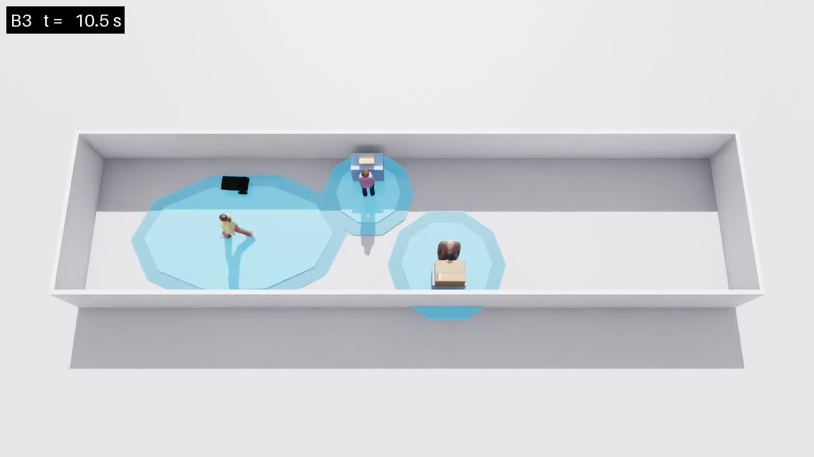
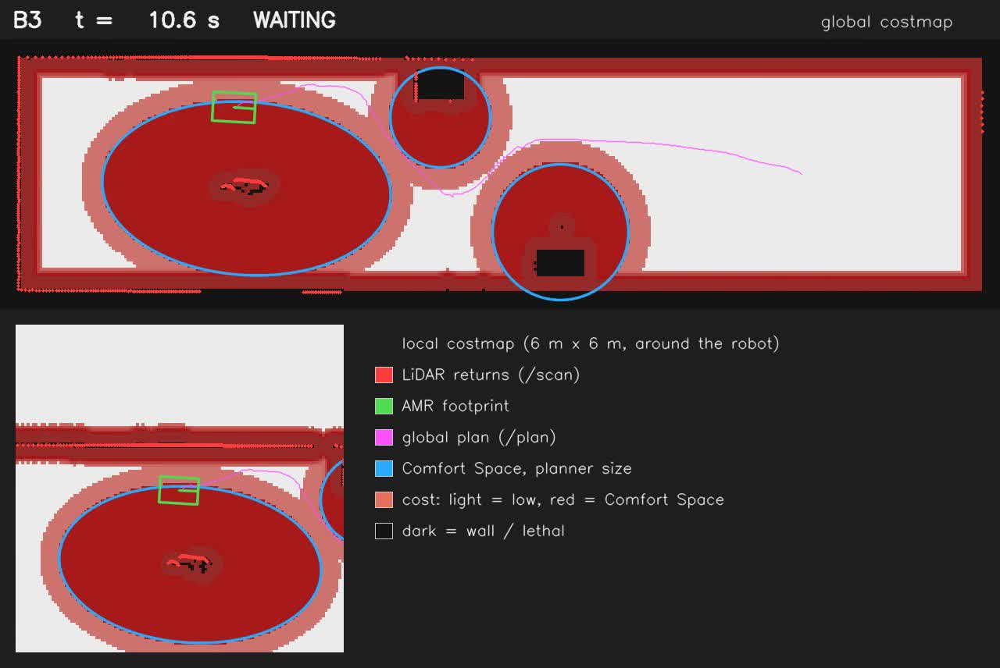

# 260926 Comfort_AMR · 양보 동작 고도화

**오늘 한 일**: 걸어오는 사람에게 양보할 때, 비켰다가 제자리에서 꼼지락거리던 동작을 없앴다. 이제 한 자리로 가서 **완전히 멈춰 기다리고**, 사람이 지나가면 출발한다.

**핵심 결과**: 대기 중 속도 명령이 정확히 0이다. 실행 중 토픽을 직접 측정해 확인했고, 오프라인 108회에서도 0이 아닌 명령이 한 번도 없다.



---

## 1. 무엇이 문제였나

세 가지가 겹쳐 있었다.

| 문제 | 증상 |
|---|---|
| 대기 자리를 계속 바꿈 | 더 나은 자리가 보이면 옮김. 사람 방향 추정이 정확해질수록 안쪽 자리가 좋아 보여 1.40 m → 1.20 m로 야금야금 이동 |
| 후보 자리가 로봇을 따라옴 | 후보를 로봇 현재 위치 기준으로 생성. 뒤로 물러날수록 후보도 뒤로 가는 되먹임. 실제로 x −4.2 → −5.4까지 밀림 |
| 도착 판정이 반복해서 깨짐 | 도착 후 정렬 회전을 하면 로봇이 약 0.2 m 밀림 → 다시 "도착 전"으로 판정 → 이동과 회전 반복 |

세 번째가 움찔거림의 직접 원인이다. 차동구동 로봇은 바퀴 축을 중심으로 돌기 때문에, 오도메트리가 보고하는 점은 제자리 회전 중에도 옆으로 미끄러진다.

---

## 2. 어떻게 바꿨나

- **자리는 한 번만 고른다.** 고른 자리가 사람의 예상 경로에 침범당할 때만(예측 점수가 경계 밑으로 떨어질 때만) 다시 고른다. 더 좋아 보인다는 이유로는 움직이지 않는다.
- **기준점 고정.** 후보 자리는 비키기 시작한 지점을 기준으로 만든다. 되먹임이 사라졌다.
- **접근은 회전 → 직진 → 정렬.** 크게 틀어졌을 때만 제자리 회전하고, 나머지는 직진한다. 마지막에 복도와 나란히 선다. 나란히 서면 사람 쪽으로 내미는 폭이 0.42 m에서 0.24 m로 줄어든다.
- **정렬 중에는 위치를 보지 않는다.** 회전 중 미끄러짐을 이탈로 오판하지 않는다.
- **완전 정지 유지.** 자리에 서면 명령을 0으로 고정한다. 0.45 m 이상 밀려나야만 다시 보정한다.
- **출발 전 한 박자.** 사람이 지나간 뒤 0.7초 멈췄다가 목표 방향으로 돌고 출발한다.
- **서 있는 사람에게 양보할 때도 제자리 회전을 없앴다.** 기다리는 동안 몸을 흔드는 것처럼 보이던 동작이다.
- **상태 공개.** 게이트가 현재 상태를 토픽으로 발행한다. costmap 영상 왼쪽 위에 글자로 표시된다.

### 상태 흐름

```
DRIVING  →  STEPPING ASIDE  →  WAITING  →  RESUMING  →  DRIVING
주행         자리로 이동        완전 정지    방향 정렬     복귀
```



---

## 3. 결과

| 시나리오 | 결과 | 주행 시간 | 걷는 사람 침범 |
|---|---|---|---|
| B3 + 걷는 사람 | 성공 | 37.9 s | 0.12 m, 1.9 s |
| B2 + 걷는 사람 | 교착 | 39.6 s | 0.12 m, 1.7 s |
| B1 + 걷는 사람 | 성공 | 26.6 s | 1.93 m, 충돌 0.5 s |
| B2 | 교착 | 27.8 s | - |
| B3 | 성공 | 26.7 s | - |

**대기 중 정지 확인** (실행 중 토픽 측정)

| 항목 | 값 |
|---|---|
| 대기 중 `/cmd_vel` | 선속도 0.00, 각속도 0.00 |
| 대기 중 실제 속도 | 0.00 m/s, 0.00 rad/s |
| 오프라인 108회, 대기 중 0이 아닌 명령 | 0건 |
| 오프라인 108회, 걷는 사람 침범 깊이 중앙값 | 0.00 m |
| 오프라인 108회, 충돌 | 0건 |

---

## 4. 시도했다 되돌린 것

**곡선 접근**: 제자리 회전 없이 한 번에 곡선으로 들어가 자세까지 맞추는 방식을 만들었다. 회전은 사라지지만 대기 자리 도착이 2.5초 늦어져, 사람이 지나가기 전 여유가 거의 없어졌다. 되돌리고 이유를 코드 주석에 남겼다.

---

## 5. 남은 점

- **정렬 회전 때 약 0.2 m 밀린다.** 그래서 고른 자리보다 사람 쪽으로 조금 가까이 선다. 침범 0.12 m의 대부분이 여기서 온다. 밀림을 예상해 자리를 바깥으로 잡거나, 곡선 접근의 속도를 개선하면 줄어든다.
- **B1의 충돌은 그대로다.** Comfort Space가 없는 기준선이므로 의도된 결과다.

---

## 6. 산출물

```
results/videos/v4_visible_yield/<시나리오>/<조건>/
  *_camera.mp4          장면 영상
  *_costmap.mp4         Nav2가 보는 화면, 좌상단에 상태 표시
  *_costmap.gif         전체 화질 GIF
  *_costmap_small.gif   노션용 (5 MB 이하)
```

시나리오는 `b1_no_comfort_space`, `b2_static`, `b3_state_adaptive`, 조건은 `standing_only`와 `with_walker`다. 이전 동작은 `v1_physical_sidestep`, `v2_comfort_aware_yield`, `v3_scan_clearing_fix` 폴더에 남아 있어 나란히 비교할 수 있다.
