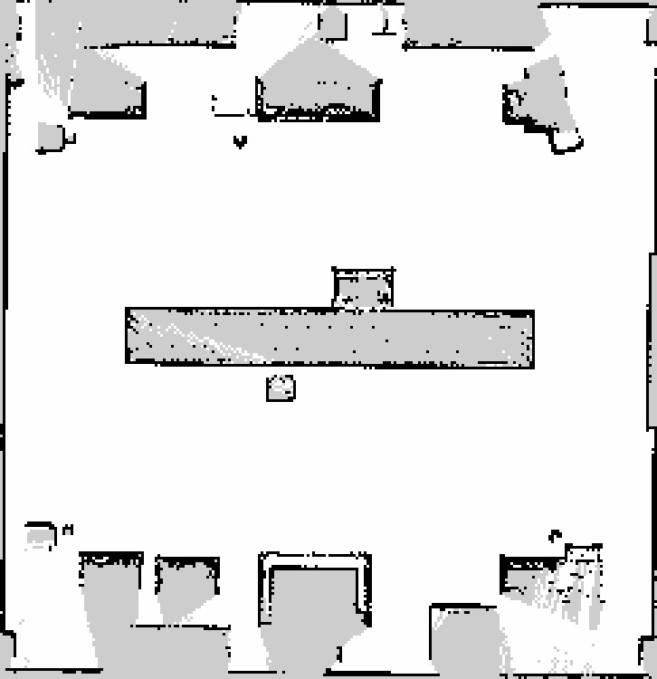
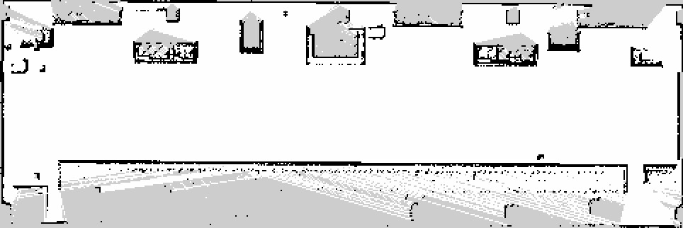
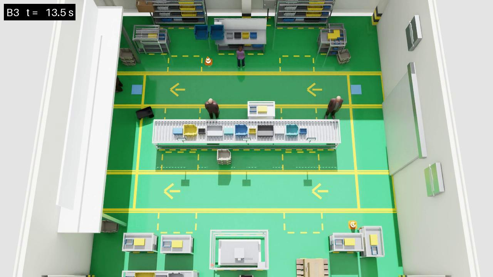
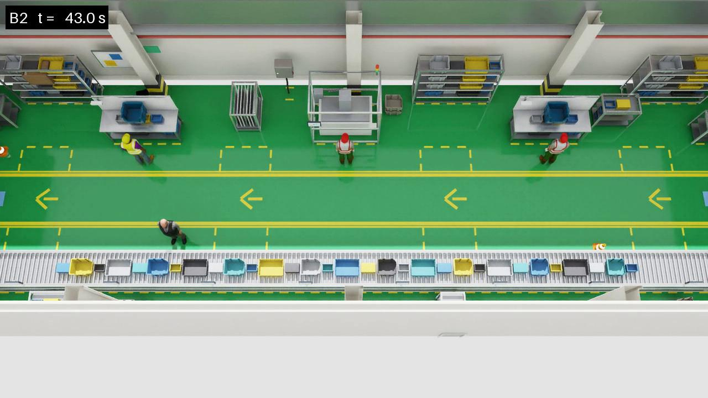

# 3D LiDAR + SLAM 버전 (2026-10-06)

인식을 3D로 바꾸고, 지도를 SLAM으로 직접 만들었습니다. **기존 2D 파이프라인은
건드리지 않았습니다** — 별도 폴더(`nav3d/`), 별도 config, 별도 녹화 버전으로
가서 9/26에 받은 결과는 그대로 유효합니다.

## 1. 무엇이 달라졌나

| | 2D (기존) | 3D (이번) |
|---|---|---|
| config | `configs/factory.yaml` | `configs/factory_3d.yaml` |
| costmap 장애물 | `ObstacleLayer` ← `/scan` 한 겹 (0.11~1.51 m) | `VoxelLayer` ← `/lidar/cloud` (0.10~1.80 m, 0.12 m 간격 16층) |
| collision monitor | `scan` 소스 | `pointcloud` 소스 |
| 지도 | config에서 생성 | **SLAM** (`nav3d/maps/`) |
| 녹화 폴더 | `v5_factory_bay` | `v7_factory_3d` |

바꾸지 않은 것: Scene, 사람 배치와 상태, B1/B2/B3 정책, NavFn + DWB,
판정 규칙, Comfort Space keepout 필터, yield gate.

## 2. 지도

빈 베이(사람 끔)를 통로 중심선 따라 2바퀴 돌며 `slam_toolbox`로 만들었습니다.
저장 뒤 `nav3d/place_map.py`가 월드 좌표로 옮깁니다 — slam_toolbox는 첫 스캔을
받은 자리(= `navigation.start`)를 원점으로 잡는데, 이 프로젝트의 나머지 전부가
월드 좌표로 말하기 때문입니다.

| | 측정된 범위 | 설계값 | 오차 |
|---|---|---|---|
| 순환형 | x[-6.07, +6.03] y[-6.30, +6.20] | ±6.00 | ≤ 0.07 m (y는 벽 두께 포함 0.30) |
| 긴 복도형 | x[-12.05, +12.05] y[-4.08, +3.97] | ±12.00 / ±3.75 | ≤ 0.33 m (벽 두께 포함) |





회색은 미탐색(설비 뒤 그림자), 검정은 점유, 흰색은 주행 가능입니다.
중앙 컨베이어와 양쪽 작업대 열이 그대로 찍혔습니다.

**지도는 한 번만 만들어 B1/B2/B3가 같은 파일을 읽습니다.** trial마다 SLAM을
돌리면 세 조건이 서로 다른 건물에서 경로를 찾게 되고, 결과 차이가 정책 때문인지
지도 때문인지 구분할 수 없습니다.

## 3. 결과

두 레이아웃 모두 B1/B2/B3 전부 SUCCESS. 아래는 전부 **녹화본**입니다
(카메라 + costmap 동시 녹화).

### 순환형 12 × 12 m — `configs/factory_3d.yaml`

| | 결과 | 시간 | 이동거리 | 걷는 사람 c 최근접 | 접촉 | Comfort Space 침범 | 안전계층 |
|---|---|---|---|---|---|---|---|
| B1 Comfort Space 없음 | SUCCESS | 33.3 s | 14.14 m | **−0.059 m (접촉)** | 2.4 s | 1.97 m 깊이 / 5.4 s | 0.9 s |
| B2 고정 1.20 m | SUCCESS | 55.9 s | 17.77 m | +0.774 m | 0 s | 0.18 m / 2.0 s | 0.1 s |
| B3 상태적응 | SUCCESS | 41.3 s | 12.91 m | +0.669 m | 0 s | 0.29 m / 2.5 s | 0.5 s |

### 긴 복도형 24 × 7.5 m — `configs/factory_long_3d.yaml`

| | 결과 | 시간 | 이동거리 | 걷는 사람 c 최근접 | 접촉 | Comfort Space 침범 | 안전계층 |
|---|---|---|---|---|---|---|---|
| B1 | SUCCESS | 60.1 s | 23.84 m | **−0.056 m (접촉)** | 1.7 s | 1.96 m / 4.7 s | 1.1 s |
| B2 | SUCCESS | 119.6 s | 26.57 m | +0.720 m | 0 s | 0.24 m / 2.3 s | **11.4 s** |
| B3 | SUCCESS | 74.7 s | 24.59 m | +0.717 m | 0 s | 0.25 m / 2.2 s | 1.0 s |

### 읽을 점

**B1은 두 레이아웃 모두 사람을 들이받습니다.** 최근접 −0.06 m, 접촉 1.7~2.4 s,
Comfort Space를 2 m 가까이 파고듭니다. 가장 빠른 대신 그렇습니다.

**돌아갈 길이 없으면 정책 차이가 훨씬 크게 벌어집니다.** 순환형에서는 B2가 B3보다
14.6 s 느린데, 긴 복도형에서는 **44.9 s** 느립니다(119.6 vs 74.7). 더 중요한 건
안전계층 작동 시간입니다 — 긴 복도형 B2는 **11.4 s** 동안 충돌 감시기가 개입했고,
B3는 1.0 s입니다. 고정 1.20 m는 복도 폭이 모자랄 때 로봇을 사람 쪽으로 밀어붙여
안전계층이 대신 멈추게 만들고, 상태적응은 서 있는 사람 옆에서 공간을 줄여 그냥
지나갑니다. 돌아갈 길이 있는 순환형에서는 이 차이가 "조금 돌아가면 그만"이라
드러나지 않습니다.

**두 레이아웃 모두 B2·B3의 최근접 거리는 사실상 같습니다**(+0.72~0.77 m).
B3가 얻는 것은 "더 멀리 비켜주는 것"이 아니라 **같은 거리를 지키면서 더 빨리
끝내는 것**입니다.

### 2D 결과와 비교 (순환형)

| | 2D | 3D | 차이 |
|---|---|---|---|
| B1 | 28.6 s / −0.062 m / 접촉 1.3 s | 33.3 s / −0.059 m / 접촉 2.4 s | 최근접 3 mm |
| B2 | 55.2 s / +0.753 m | 55.9 s / +0.774 m | 최근접 21 mm |
| B3 | 37.7 s / +0.649 m / 12.16 m | 41.3 s / +0.669 m / 12.91 m | 최근접 20 mm |

인식을 3D로 바꿔도 **정책의 효과는 같습니다**. 최근접 거리는 모두 2 cm 안쪽이고,
시간은 3D가 조금 깁니다(costmap 갱신이 무거워 제어 주기가 가끔 밀립니다).

**앞선 보고 정정**: 녹화 없이 돌린 3D B3는 48.8 s / 16.60 m였고, "통로를 비집는
대신 순환로를 반대로 돌았다"고 적었습니다. 같은 조건을 다시 돌리니 41.3 s /
12.91 m로 **통로를 그대로 지나갔습니다**. 즉 우회 여부는 2D/3D 차이가 아니라
**같은 조건에서도 실행마다 뒤집히는 선택**입니다. Comfort Space가 통로를 막았을 때
좌/우 우회 비용이 거의 같아서 생기는 일로 보이며, 어느 쪽이 전형적인지는 반복
실행을 더 해봐야 압니다.

## 4. 도중에 잡은 문제

| 증상 | 원인 | 조치 |
|---|---|---|
| 첫 3D trial이 8.9 s만에 Nav2 ABORTED | 전역 costmap 240×240×16 복셀 격자를 초당 2회 발행(`publish_voxel_map`)해서 costmap이 갱신 기한을 놓침 | 껐습니다. 디버깅용이지 주행용이 아닙니다 |
| 〃 | `expected_update_rate: 0.5`를 넣었는데 RTX LiDAR는 0.5~1.0 s씩 띄엄띄엄 발행 → 버퍼가 계속 비워짐 | 뺐습니다. 2D 템플릿도 쓰지 않습니다 |
| 매핑 주행이 한 다리에서 멈춤 | Isaac Sim에서 바퀴가 걸림(90 s에 0.5 m) | `patrol.py`에 정체 감지(6 s / 8 cm) + 후진 재시도 추가 |
| 녹화 영상이 전부 흰 화면 | 녹화 카메라는 17 m 높이인데 베이 천장이 5 m라 천장만 찍힘 | `recording.hide`로 녹화 중 천장을 숨김. LiDAR 최고 반사 높이가 3.84 m라 인식에는 영향 없음 |
| B2 trial이 기동 중 죽음 | GPU 크래시(`VK_ERROR_DEVICE_LOST`). 직전 trial이 GPU를 놓자마자 다시 띄워서 생김 | 코드 문제 아님. 배치에 trial 사이 25 s 간격 |
| Comfort Space 마스크가 다른 지도를 참조 | `comfort_publisher.py`가 생성 지도 경로를 직접 들고 있었음 | `comfort_core.nav2_map()` 한 곳으로 모아 Nav2·마스크가 같은 파일을 읽게 |

## 5. 쓰는 방법

```bash
./scripts/run_mapping.sh --config configs/factory_3d.yaml --headless   # 지도 한 번
./scripts/run_b1.sh --headless --config configs/factory_3d.yaml
./scripts/run_b2.sh --headless --config configs/factory_3d.yaml
./scripts/run_b3.sh --headless --config configs/factory_3d.yaml
```

긴 복도형은 `configs/factory_long_3d.yaml`. 지도는 이미 만들어뒀습니다.

## 6. 영상

여섯 trial 전부 카메라 + costmap 녹화입니다.

```
results/videos/v7_factory_3d/{b1_no_comfort_space,b2_static,b3_state_adaptive}/factory_3d/
results/videos/v7_factory_long_3d/{b1_no_comfort_space,b2_static,b3_state_adaptive}/factory_long_3d/
```

각 폴더에 `<시각>_camera.mp4`(위에서 본 베이), `<시각>_costmap.mp4`,
`<시각>_costmap.gif`, `<시각>_costmap_small.gif`가 있습니다. 카메라 영상은
시뮬레이션 시계 기준 10 fps로 찍고 같은 속도로 인코딩하므로, Isaac Sim이
실제로 몇 배속으로 돌았든 **시뮬레이션 실시간**으로 재생됩니다.





긴 복도형 B2 영상에서 안전계층이 11.4 s 동안 개입하는 구간이 그대로 보입니다 —
고정 1.20 m가 좁은 복도에서 어떻게 로봇을 밀어붙이는지 확인할 수 있습니다.

자세한 설계 근거는 [nav3d/README.md](../../../nav3d/README.md).
