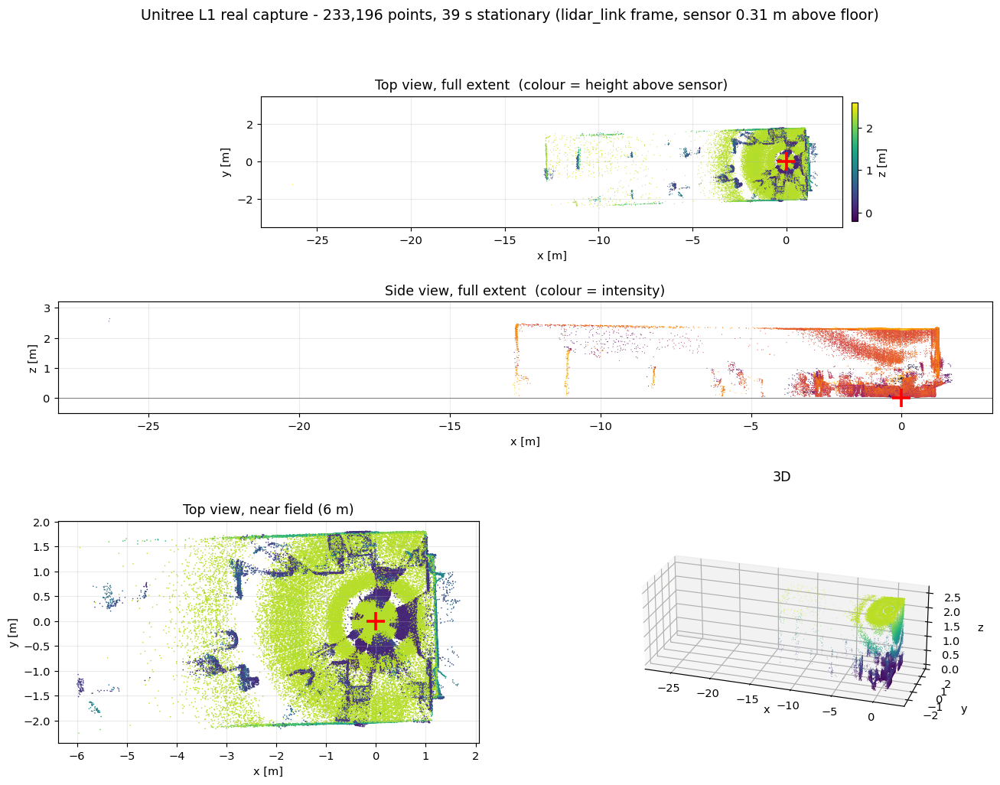

# 실기 AMR 원격 연결 + Unitree L1 센서 프로파일 (2026-10-11)

오늘 한 일은 두 가지입니다. **실기 로봇을 모니터 없이 원격으로 쓸 수 있게 만든 것**, 그리고 **거기서 측정한 값으로 시뮬레이션용 LiDAR 센서를 만든 것**.

---

## 1. 실기 AMR 원격 연결

### 결과

```bash
ssh clabil@clabil.local
```

IP를 찾을 필요도, 모니터를 붙일 필요도 없습니다. 재부팅해도 유지됩니다.

기존 운용 문서에는 *"전원 켤 때마다 IP가 바뀌므로 미니PC에서 `hostname -I`로 확인 필요"* 라고 되어 있었는데, 확인해보니 `avahi-daemon`이 이미 설치·구동 중이었습니다. mDNS 이름으로 접속하면 IP 변경과 무관합니다. **없던 걸 만든 게 아니라 있던 걸 안 쓰고 있었습니다.**

### 한 작업

| 항목 | 내용 |
|---|---|
| SSH 키 등록 | 비밀번호 없이 접속, 스크립트 자동화 가능 |
| mDNS 확인 | `clabil.local` → `192.168.0.9` |
| tmux 설치 | SSH가 끊겨도 bringup이 살아있음 |
| 재부팅 검증 | 24초 만에 복귀, SSH·avahi·udev 규칙 모두 자동 복원 |
| 데스크톱 WiFi | `NSLab#1` 연결 (`192.168.0.44`), 인터넷은 유선 유지 |

### 확인된 하드웨어

- **NVIDIA Jetson Orin Nano Developer Kit (Super)**, ARM64, 8 GB RAM
- Ubuntu 22.04.5 + ROS 2 **Humble**
- 저장: microSD 57 GB 중 29 GB 여유, 쓰기 **51.7 MB/s** — bag 녹화에 충분
- 배터리 24.0 V / 100 %

### 운용 메모

- bringup 인자 주의: `pkg:="robot"`는 모터만, **LiDAR까지 쓰려면 `pkg:="robot lidar"`**
- 재부팅 직후 bringup을 올리면 LiDAR 드라이버가 센서 스트리밍보다 먼저 포트를 열어 **조용히 멈춥니다.** 재시도를 안 하므로 `/lidar/cloud`가 비면 디버깅하지 말고 bringup만 다시 올리면 됩니다
- **토픽 이름이 시뮬레이션과 동일합니다** — `/cmd_vel`, `/odom`, `/lidar/cloud`, `/joint_states`, `/tf`. 나중에 실기↔시뮬 비교 시 이름을 바꿀 필요가 없지만, 동시에 돌리면 섞이므로 `ROS_DOMAIN_ID` 분리가 필요합니다

---

## 2. LiDAR 정체 확인 및 실측

### 모델: Unitree 4D LiDAR L1 (두 경로로 확인)

1. SDK README — *"specially used for running Unitree LiDAR L1"*
2. 실측 수직 FOV **88.3°** → L1(90°)과 일치, L2(96°) 아님

### 측정 방법

로봇을 **세워둔 채** 39초 녹화(13 MB). 움직일 필요가 없어 주변이 복잡한 환경에서도 안전했습니다.



비반복 스캐너라 39초를 누적하면 **233,196점**으로 방 전체가 찍힙니다.

### 실측 제원

| 항목 | 값 |
|---|---|
| 수직 FOV | **0° ~ +89°** (위쪽만) |
| 수평 | 360° |
| 점 수 | 597개/메시지, **5,889 점/초** |
| 주기 | 9.4 Hz (IMU 243 Hz) |
| 거리 | 실측 0.28~13.0 m (사양 0.05~30) |
| 필드 | x, y, z, intensity, ring, time |
| 장착 | 바닥에서 **0.31 m**, 회전 없음 |

### 중요한 발견 두 가지

**① 수평 아래를 보지 않습니다.** 고도각이 전부 양수입니다. 돔이 위를 향한 L1이 자기 높이부터 위쪽 반구만 봅니다. 바닥과 0.31 m 아래 물체는 원리적 사각지대이고, 그래서 이 로봇에 전후방 초음파 센서가 따로 달려 있습니다.

**② 기존 시뮬레이션 센서와 정반대였습니다.**

| | 실기 L1 | 기존 시뮬 (Example_Rotary) |
|---|---|---|
| 수직 FOV | **0° ~ +90°** | **−15° ~ +10°** |
| 점/프레임 | 593 | 438,150 |

아래를 보는 센서와 위를 보는 센서입니다. **기존 3D costmap 결과는 다른 센서로 받은 값**이라 다시 받아야 합니다.

### 장착 위치는 이미 맞았습니다

```
base_footprint → base_link   z +0.210
base_link      → lidar_link  (+0.080, 0, +0.100), 회전 없음  = 바닥 0.31 m
```

시뮬레이션 설정과 정확히 일치 — 이 부분은 고칠 것이 없습니다.

---

## 3. Isaac Sim용 센서 프로파일 작성

### 결과물

```
nav3d/lidar_configs/Unitree_L1.json    실측 프로파일 (측정 기록)
nav3d/lidar_configs/Unitree_L1.usda    Isaac 센서 정의
nav3d/lidar_configs/make_usda.py       json → usda 생성기
nav3d/analyze_lidar_bag.py             bag에서 센서 제원 역산
nav3d/real_lidar.rviz                  실측 점군 시각화 설정
```

### 검증 (실기 대비)

| | 실기 | 프로파일 |
|---|---|---|
| 점/프레임 | 593 | **594** |
| 점/초 | 5,889 | 5,940 |
| 고도각 | 0° ~ +89° | **+1.8° ~ +86.2°** |
| 주기 | 9.4 Hz | 10 Hz |

고도각 **분포**까지 맞췄습니다. 실측이 수평 근처(0~20°)와 천정 근처(80~90°)에 몰리고 중간이 얇은데, 18개 에미터를 그 밀도대로 배치했습니다.

### 재현하지 않은 것

L1은 **비반복 스캐너**입니다. `ring` 필드는 레이저 라인이 아니라 스윕 순번이고(18개 링 전부가 0~89° 전 범위를 덮음), 매 스윕이 다른 방향을 칠해 1~2초에 걸쳐 빈 곳이 메워집니다. 프로파일은 18 고도각 × 33 방위각 **고정 격자**라 평균적으로는 같은 점을 내지만 매 회전 같은 방향만 봅니다. **레이 사이에 들어간 가는 물체는 시뮬에서 영영 안 보이고, 실기는 다음 스윕에 잡습니다.**

### Isaac Sim 함정 4건 (전부 소스 분석/이분탐색으로 확인)

1. **`config="이름"`으로 JSON 지정은 조용히 무시됩니다.** `SUPPORTED_LIDAR_CONFIGS`에 등록된 23개만 유효하고, 나머지는 경고 한 줄 남기고 기본 센서로 대체됩니다 — 센서가 바뀐 줄 알고 실험을 돌리게 됩니다
2. **생성된 센서의 속성을 코드로 바꾸면 Isaac이 죽습니다.** 플러그인이 에미터 배열을 생성 시점에 캐시하고 개수만 다시 읽어 `Malformed model parameter length`로 abort
3. **에미터 배열 10종 전부** 길이가 `numberOfEmitters`와 같아야 합니다
4. **`channelId`는 1부터입니다.** 0부터 매기면 **센서 전체가 아무것도 내보내지 않습니다** — 오류도 경고도 로그도 없음. Isaac 원본과 값을 하나씩 바꿔가며 이분탐색으로 찾았습니다

---

## 다음

- AMR USD의 센서 참조를 `Example_Rotary` → `Unitree_L1.usda`로 교체 (교체 즉시 기존 3D 실험 결과는 무효)
- 주행 bag 녹화 → 실기/시뮬 odometry 비교 (바퀴 반지름·트레드 캘리브레이션)
- 실기 footprint 864 × 570 mm vs 시뮬 700 × 480 mm — 통로 폭 판정에 직접 들어가는 값이라 맞춰야 함
