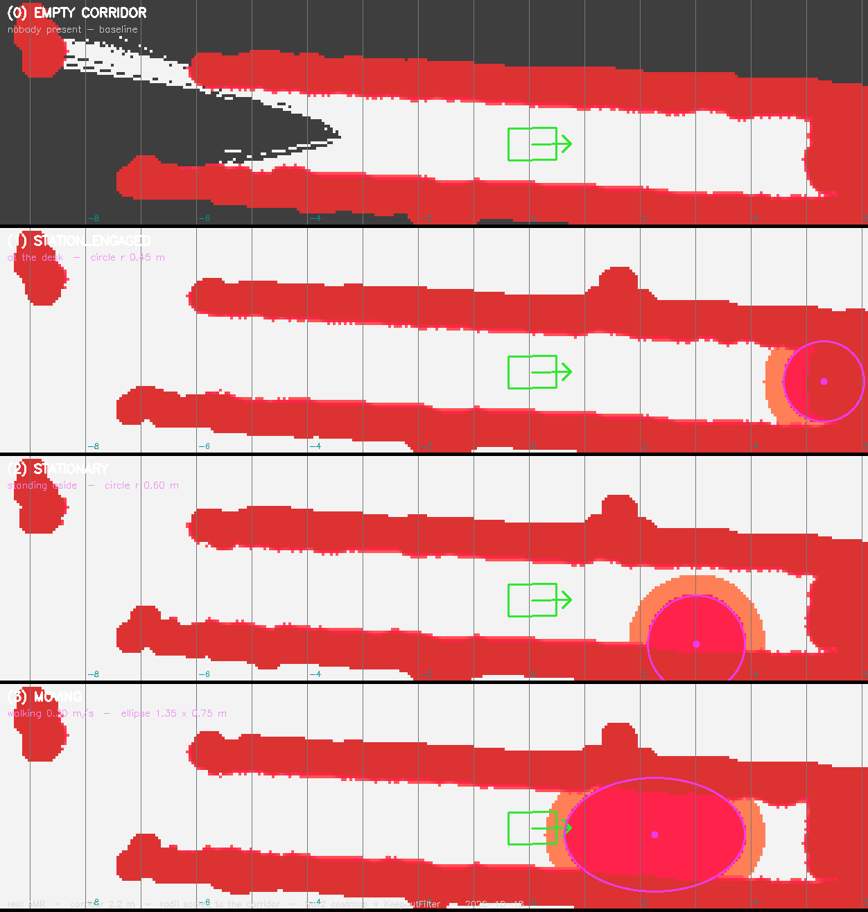
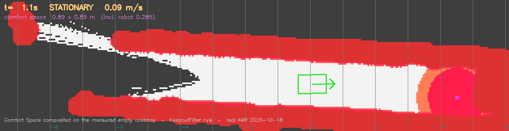
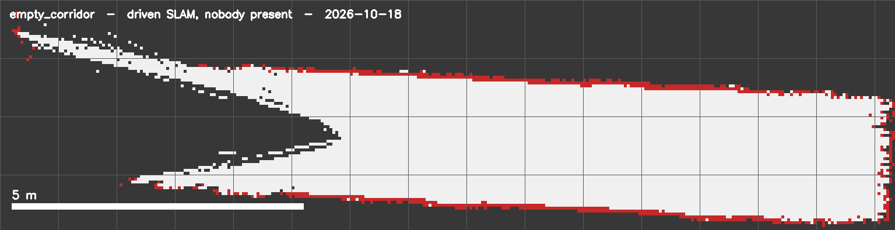
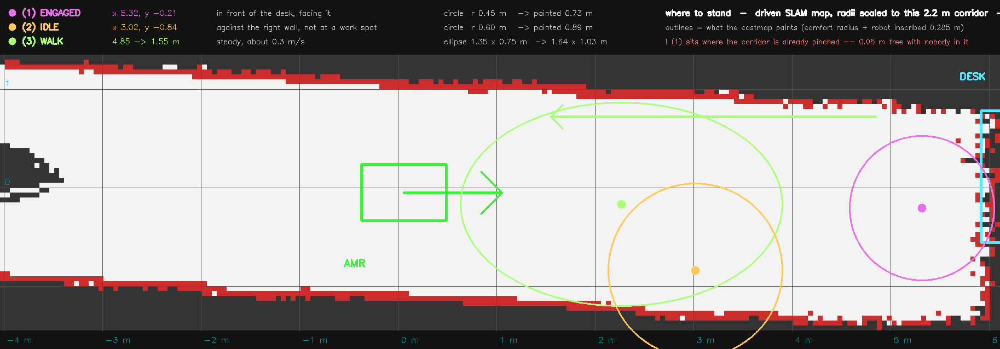
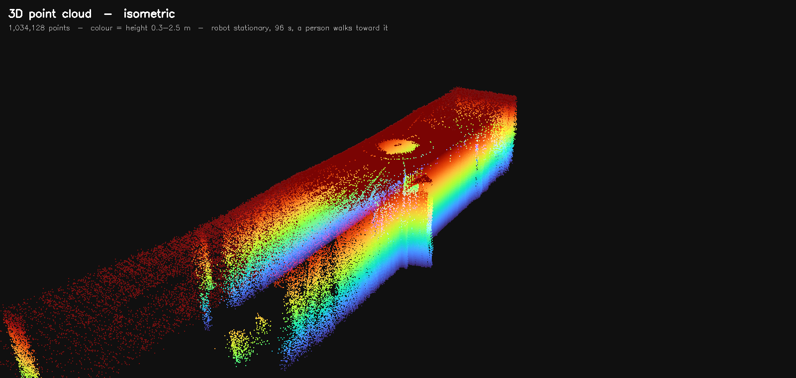
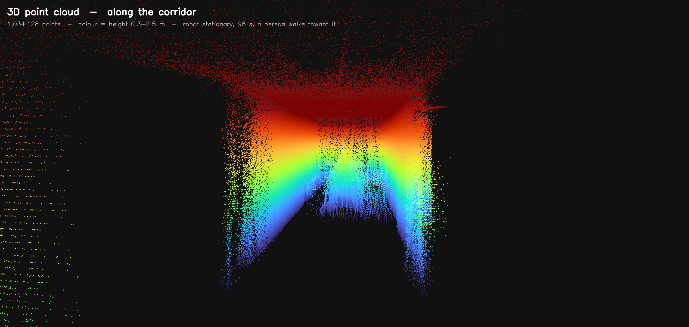

# 실기 AMR — 사람이 있을 때 Comfort Space costmap (2026-10-18)

목표는 하나였습니다.

> **사람이 있을 때, 시뮬레이션에서 설계한 Dynamic Comfort Space를 실기 Nav2 costmap에도 올릴 수 있는가.**

**된다.** 세 상태 모두 실기에서 그려졌고, 반경이 설정값과 셀 단위로 일치합니다.

다만 값을 그대로 옮기면 안 됩니다. 시뮬 값은 2.2 m 복도에서 **사람 하나가 통로를
완전히 막습니다.** 복도 크기에 맞춰 다시 잡았습니다.

---

## 1. 결과물



빈 복도 기준선 + 세 상태. 자홍색 외곽선이 설정값, 채워진 빨강이 Nav2 costmap이
실제로 받은 비용입니다.

| 상태 | 사람 위치 | 반경 | costmap에 칠해진 크기 |
|---|---|---|---|
| `station_engaged` | (+5.32, −0.21) | 0.45 m | 0.73 m 원 |
| `stationary` | (+3.02, −0.84) | 0.60 m | 0.89 m 원 |
| `moving` | (+2.27, −0.17) | 1.35 × 0.75 m | 1.64 × 1.03 m 타원 |

칠해진 크기가 **0.285 m 큽니다.** 의도된 동작입니다 — 설정 반경은 사람에서 로봇의
*가장 가까운 부분*까지의 거리인데, 플래너는 로봇을 점으로 다루므로 피할 도형을
로봇 내접반경만큼 키워야 합니다.

마스크 격자가 costmap과 **셀 단위로 일치**합니다(313×81, 0.05 m, 원점 동일).
어긋나면 칠해진 반경이 설정 반경과 달라집니다.

### 통행 가능성

로봇 **중심**이 지나갈 수 있는 폭:

| 지점 | 빈 복도 | 사람 있을 때 |
|---|---|---|
| x +3.02 `stationary` | 1.50 m | **0.50 m** |
| x +2.27 `moving` | 1.45 m | **0 — 막힘** |
| x +5.32 `station_engaged` | 0.05 m | 0 (비교 불가) |

- **걷는 사람 하나가 복도를 완전히 막습니다.**
- **비켜선 사람은 0.50 m를 남깁니다.** 이게 설계 의도입니다.
- x +5.32는 **빈 복도에서도 0.05 m**뿐입니다. 책상과 끝벽이 이미 좁혀놓은 지점이라
  Comfort Space의 기여를 분리할 수 없습니다. 다음에 `station_engaged`를 제대로
  보려면 Station을 복도가 열린 곳에 두어야 합니다.

---

## 2. 복도 크기에 맞춘 반경

처음 쓴 값은 시뮬레이션의 **3.9 m 복도 / 12 m 공장 베이**에 맞춘 것이었습니다.
2.2 m 복도에서는 세 상태 모두 통로를 막았습니다.

측정된 빈 복도 costmap에서 직접 계산했습니다. 여기서 로봇 **중심**이 다닐 수 있는
띠는 1.35~1.45 m입니다.

**벽 쪽에 선 사람** (y −0.84) — 틈이 선형으로 줄어듭니다.

| 반경 | 칠해진 반경 | 남는 틈 |
|---|---|---|
| 0.45 m | 0.73 | 0.60 m |
| **0.60 m** | **0.89** | **0.46 m** ← 채택 |
| 0.75 m | 1.03 | 0.31 m |
| 0.90 m (시뮬값) | 1.19 | 0.16 m |

**복도 한가운데 선 사람** (y −0.17) — 어떤 값도 안 됩니다.

| 반경 | 남는 틈 |
|---|---|
| 0.20 m | 0.24 m |
| 0.40 m | 0.04 m |
| **0.50 m 이상** | **0** |

정책이 아니라 **기하학**입니다. 2.2 m − 사람 0.5 m − 로봇 0.57 m = 1.13 m가 남고,
가운데 서면 양쪽으로 갈려 각각 0.56 m뿐입니다.

### 채택값

| 상태 | 시뮬 | 이 복도 |
|---|---|---|
| `station_engaged` | 0.60 | **0.45** |
| `stationary` | 0.90 | **0.60** |
| `moving` | 1.20 | **0.75** |

대략 **×0.65**. 설계 의도는 **"비켜선 사람은 지나갈 수 있게, 가운데 선 사람은
양보 상황으로"** 입니다. 후자를 억지로 통과시킬 게 아니라 로봇이 서야 하는
상황이고, 그것이 yield 정책이 존재하는 이유입니다.

### 타원

`moving`만 진행축으로 1.8배 늘어납니다. 나머지 두 상태는 원형입니다.

타원은 사람을 중심으로 **대칭**이라 앞만큼 뒤도 덮습니다. costmap에는 시간축이 없어
"앞쪽 절반"만 남기려면 예측이 필요하고, 그건 `comfort_core/evasion.py`가 시간을
써서 따로 합니다.

---

## 3. 실시간 — GIF와 블로커



실측 추적 22프레임. **상태를 지정하지 않았습니다** — `comfort_core/human_state.py`의
규칙(0.15 m/s 초과 = `moving`)이 측정 속도에 적용되어 저절로 바뀝니다.

```
 1.1~ 5.5s  STATIONARY  0.01~0.14 m/s   원   0.89 m
 6.6~17.7s  MOVING      0.19~0.36 m/s   타원 1.64 x 1.03 m
18.8~24.5s  STATIONARY  0.00~0.08 m/s   원   0.89 m
```

### 재현이지 녹화가 아닙니다

Nav2의 `CostmapFilter::updateBounds`는 아무것도 하지 않습니다. 마스크는 **다른
레이어가 "여기 바뀌었다"고 표시한 구간에만** 칠해집니다. 로봇이 서 있고 장면이
안 바뀌면 그 구간이 거의 없어서 **마스크를 바꿔도 costmap이 그대로입니다.**

측정: `stationary`와 `moving` 캡처의 고비용 셀 수가 5198개로 **완전히 동일**했습니다.
캡처마다 Nav2를 재시작해 전체를 다시 계산시켜 우회했습니다.

그래서 GIF는 측정된 빈 복도 costmap 위에 KeepoutFilter와 **같은 규칙**으로
합성했습니다. 같은 포즈를 라이브로 찍은 것과 비교해 **IoU 0.894**로 검증했습니다.

**이것이 실시간화의 정확한 블로커입니다** — 검출도, 추적도, 속도 측정도, 상태
판정도 데이터로 동작합니다. costmap만 안 따라옵니다.

---

## 4. 사람 검출 — 3D가 필요한 지점

상태 판정은 위치·속도·지도만 있으면 되고 3D가 필요 없습니다. **사람이 거기 있다는
것 자체를 찾는 데** 3D가 필요합니다.

이 LiDAR는 0.31 m에서 **위쪽만** 봅니다. 그래서 사람은 **0.3~1.7 m로 솟은 가느다란
기둥**, 책상은 **0.99 m에서 끝나는 납작하고 넓은 덩어리**로 찍힙니다. `/scan`으로
평탄화하면 둘 다 같은 점 뭉치가 됩니다. **높이가 유일한 구분 단서이고, 평탄화가
그걸 파괴합니다.**

| 단계 | 거르는 것 |
|---|---|
| 높이 0.20~2.00 m | 천장 (이 복도는 2.7 m) |
| 빈 복도 배경 빼기 | 벽·책상·기존 구조물 |
| 기둥 모양 판정 | 폭 0.20~0.90 m, 높이 ≥0.90 m, 수직 길이 ≥0.50 m |

빈 복도로 검증: 남는 점 **0개**, 오탐 없음.

| 자리 | 검출 위치 | 점 | 높이 | 수직 길이 | 폭 |
|---|---|---|---|---|---|
| 책상 앞 | (+5.32, −0.21) | 64 | 1.58 m | 1.21 m | 0.66 m |
| 벽 쪽 | (+3.02, −0.84) | 73 | 1.47 m | 1.10 m | 0.50 m |

두 번째는 표시한 자리에서 **2 cm** 차이였습니다.

**실패했던 접근:** 처음에는 SLAM 지도로 배경을 빼려 했는데, 로봇이 정지 상태라
점유 셀이 70개뿐이어서 벽이 안 지워졌고 **폭 0.1 m짜리 벽 조각이 "사람"으로**
잡혔습니다. 같은 센서로 찍은 빈 복도 점군을 배경으로 쓰니 해결됐습니다.

### 걷는 사람 추적

책상 앞에서 로봇 쪽으로 걸어오는 24초를 1초 창으로 추적. **22회 연속 포착, 끊김
없음.** 전 구간 높이 1.59~1.94 m, 폭 0.43~0.85 m 유지. **측정 보행 속도 0.30 m/s.**

교차검증이 됩니다 — 임계값이 0.15 m/s이므로 **센서만으로도 `moving`으로 분류**됩니다.
선언한 상태와 센서 판정이 일치합니다.

창 1.0초는 타협입니다. 비반복 스캐너라 5 m에서 사람에게 맞는 점이 **스윕당 약 2개**뿐,
0.3초 창으로는 군집이 안 됩니다. 대신 1초 동안 걸은 거리만큼 번집니다.

---

## 5. SLAM 지도



| | 기존 `map_nsl1` | 정지 상태 | **주행** |
|---|---|---|---|
| 점유 셀 | 2007 | 70 | **709** |
| 고립 점 | 5.6 % | 4.5 % | **1.1 %** |
| 자유셀 최근접 벽 거리(중앙값) | 0.16 m | — | **0.47 m** |

**기존 지도가 망가진 원인:** 로봇 `.bashrc`의 `lidar` alias가 `max_height:=2.0`,
`min_height` 미지정, `range_min:=0.0`. L1은 **위쪽만** 보므로 높이 0~2.0 m를 2D로
누르면 **천장 구조물이 엉뚱한 수평거리의 벽**으로 찍힙니다. 자유공간의 절반 이상이
0.16 m 안쪽에 장애물을 두게 되어, inflation을 먹이면 복도 전체가 통행 불가였습니다.

시뮬과 같은 슬랩(lidar_link 기준 −0.20~+1.20 m)으로 바꾸니 유효 빔 230개/메시지,
벽이 직선으로 나왔습니다.

**정지 지도로는 부족합니다.** 로봇이 서 있는 채로 만들면 점유 셀이 70개뿐이고,
Nav2가 각 점을 0.45 m로 부풀려 **벽에서 튀어나온 동그라미**를 만듭니다. 주행해서
찍으면 벽이 연속이 되고 inflation이 매끄러운 띠가 됩니다.

오도메트리는 보정 없이 충분했습니다 — **9.4 m 주행에 횡방향 오차 12 cm**,
3.5 m 왕복 6회에서 매번 3.502 m.

---

## 6. 다음 측정을 위한 배치



외곽선은 **costmap이 실제로 칠하는 크기**입니다. 그림에서 바로 통행 여부가 읽힙니다.

---

## 7. 3D 점군 지도





96초 bag의 점군 782장을 누적했습니다 — **1,034,128 포인트**, 17.1 × 3.9 × 2.4 m.
782장 전부 TF가 붙어 한 장도 버리지 않았습니다.

**이 녹화에서 로봇은 움직이지 않았습니다** (주행거리 0.000 m). 17 m가 찍힌 건 주행해서가
아니라 L1이 한 자리에서 그만큼 보기 때문입니다. 녹화 구간은 17:46:59~17:48:35, 즉
**걷기 측정**입니다. 주행 매핑(18:03)은 녹화를 끈 뒤라 bag에 없습니다.

**`station_engaged`와 `stationary` 시점은 녹화되지 않았습니다** — 그 캡처는 17:43~17:45이고
녹화 시작이 17:46:57입니다. 17:11에 걸어둔 녹화는 빈 복도만 담겨 지웠고, 두 캡처 전에
다시 켜지 않았습니다. 두 상태의 3D 점군은 없고, 검출 수치와 costmap 캡처만 남아 있습니다.

slam_toolbox는 2D 점유격자만 만듭니다. 3D는 이렇게 **원본 점군을 궤적에 얹어** 따로
복원해야 하고, 그래서 bag에 `/lidar/cloud`와 `/tf`를 함께 녹화해둔 것입니다.

단면 그림의 **아래쪽 빈 삼각형이 이 센서의 사각지대**입니다. L1은 0.31 m에서 위쪽만
보므로 바닥이 통째로 없습니다. 천장(2.7 m)과 조명 기구는 또렷하게 찍힙니다.

| 파일 | 용도 |
|---|---|
| `corridor_cloud.ply` (15.5 MB) | Blender·CloudCompare·MeshLab에서 직접 열기 |
| `cloud3d_iso.png` / `cloud3d_side.png` / `cloud3d_top.png` | 바로 보는 렌더 |
| `cloud3d_turntable.gif` | 360° 회전 |
| `cloud_viewer/view.sh` | 브라우저에서 마우스로 돌려보기 + 타임라인 재생 |

### 인터랙티브 뷰어

`cloud_viewer/view.sh`가 로컬 서버를 띄웁니다(데이터는 밖으로 나가지 않음). 설치할 것
없음 — three.js를 로컬에 복사해뒀습니다.

타임라인으로 782스윕을 재생할 수 있고 세 가지 모드가 있습니다.

| 모드 | 보이는 것 |
|---|---|
| accumulate | 지금까지 쌓인 전부 — 지도가 만들어지는 과정 |
| one sweep | 그 순간의 **1282~1570점뿐** — 센서가 얼마나 희소한지 |
| short trail | 최근 25스윕(2.5초) |

걷는 사람을 **흰색으로 표시**해뒀습니다. 로봇에서 쓴 것과 같은 기둥 판정(폭 0.25~0.85 m,
높이 1.30~1.95 m, 수직 길이 ≥0.70 m, 벽에서 떨어짐)을 1초 창마다 적용한 결과이고,
98개 창 중 39개에서 잡힙니다.

검출 궤적: **0~20초 x≈4.50 정지(책상 쪽) → 23~32초 3.88→1.25로 접근.** 그 뒤 로봇에
바짝 붙어 계신 구간은 폭 조건을 벗어나 놓칩니다.

여기서도 실패를 두 번 겪었습니다. **빈도로 배경을 빼는 방법**은 스윕당 점 1320개가
점유 셀 2800개에 흩어져 벽조차 소수 스윕에만 찍히므로 동작하지 않았고, **시간 구간으로
가르는 방법**은 선생님이 costmap 캡처 동안 로봇 옆에 오래 서 계셔서 그 셀이 녹화
전체에 걸쳐 나타나 구조물로 분류됐습니다.

bag에 `metadata.yaml`이 없어 `ros2 bag`으로는 안 열립니다(tmux 세션과 함께 죽어서
정상 종료되지 않음). `.db3`를 sqlite로 직접 읽으면 됩니다 —
`results/real/261018/bag_to_3d.py`.

---

## 8. 인프라에서 확정된 것

### Humble과 Jazzy는 같은 DDS 도메인에 둘 수 없다

데스크톱(Jazzy)을 로봇 도메인에 넣는 순간 모든 Humble 노드가
`'Bad alloc' exception deserializing rmw_dds_common::msg::ParticipantEntitiesInfo_`
를 뱉고 그래프가 죽습니다. 로봇 자신의 `ros2 node list`조차 빕니다.

→ **Nav2·SLAM·Comfort Space 전부 온보드.** 데스크톱은 Humble 컨테이너 안의 RViz
   또는 foxglove websocket으로만 봅니다. AP가 무선 클라이언트 간 멀티캐스트도
   차단하므로 컨테이너는 FastDDS 유니캐스트 프로파일을 씁니다.

### Nav2 기본값 두 가지가 이 로봇에 안 맞는다

- `obstacle_max_range: 2.5` / `raytrace_max_range: 3.0` — **12 m를 보는 LiDAR에
  3 m 범위**입니다. 로봇에서 5.3 m 떨어진 Comfort Space가 costmap에 전혀 안
  올라갔습니다(마스크 98, costmap 0). **10.0 / 12.0**으로 수정.
- `inflation_radius` — 2.2 m 복도에서는 넓은 inflation이 복도를 먹습니다.
  **0.35 m**로. 로봇 내접반경 0.285 m가 하한이고, 그 안쪽은 설정과 무관하게
  치명 비용입니다.

### 필터는 마지막 마스크를 계속 붙든다

`comfort_publisher`를 꺼도 Comfort Space가 costmap에서 안 사라집니다
(transient_local 캐시). baseline을 찍으려면 **빈 마스크를 명시적으로 발행**하거나
Nav2를 재시작해야 합니다.

### 하드웨어

첫 번째 AMR은 **구동 보드 배선 2개가 끊어져** 못 썼습니다. 증상이 전부 1분 안에
보이는 것들이었습니다.

```
battery_voltage     0.0      (10월 11일에는 24.0 V)
motor_encoder_sub   nan
bringup.log         "written" 195회 / "parsed successfully" 0회
dmesg               usb 1-2.2 disconnect 반복, error -71
```

그래서 `preflight.sh`를 만들었습니다 — 7개 항목을 1분 안에 확인합니다. 두 번째
AMR에서 7/7 통과 후 바로 진행했습니다.

---

## 다음

1. **실시간화** — 블로커는 검출이 아니라 costmap입니다. `KeepoutFilter` 대신
   커스텀 costmap 레이어를 쓰거나, 마스크 변경이 전체 갱신을 유발하게 해야 합니다.
   그 뒤에 검출 결과를 TF로 발행하면 `comfort_publisher`가 코드 수정 없이
   따라옵니다 — seam이 이미 그렇게 설계돼 있습니다.
2. **Station 재배치** — 지금 책상 자리는 빈 복도에서도 0.05 m뿐이라
   `station_engaged`를 측정할 수 없습니다.
3. ~~3D 점군 지도~~ — 완료. 7절 참조.

---

## 파일

| | |
|---|---|
| `costmap_four_panels.png` | 빈 복도 + 세 상태 |
| `comfort_space_walk.gif` | 걷는 사람을 따라가는 Comfort Space (22프레임) |
| `costmap_empty_corridor.png` | 빈 복도 기준선 |
| `map_empty_corridor.png` | 주행 SLAM 지도 |
| `where_to_stand.png` | 다음 측정용 배치도 |
| `scan_corridor_261018.png` | 슬랩 수정 후의 `/scan` |
| `results/real/261018/*.npz` | costmap 원본 격자, 추적 기록 |
| `results/real/bags/walk_174657/` | cloud + TF + scan + odom (50 MB) |
| `corridor_cloud.ply` | 3D 점군 1,034,128 포인트 |
| `results/real/amr_deploy/` | 로봇에 올라간 스크립트 일체 + 배포 스크립트 |
