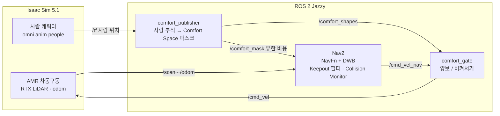
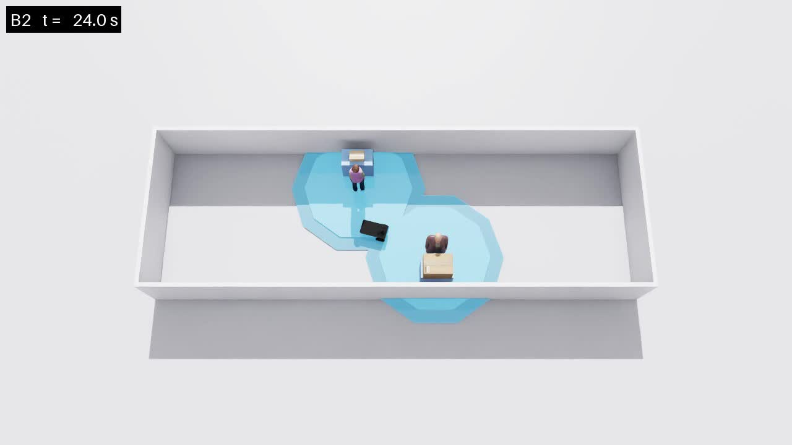
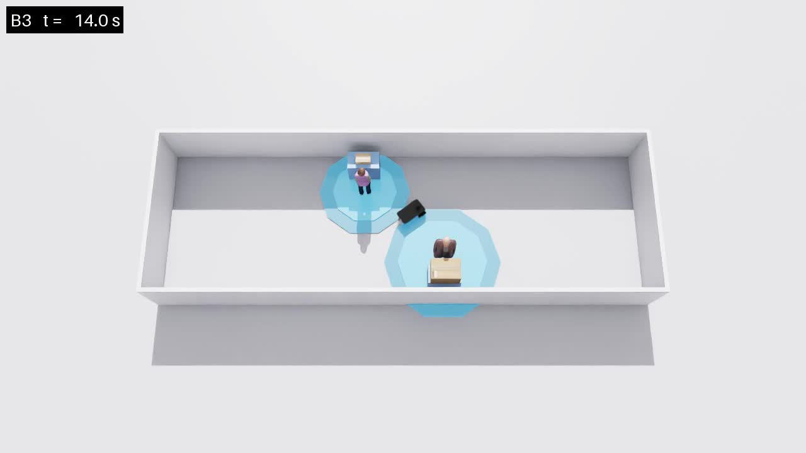
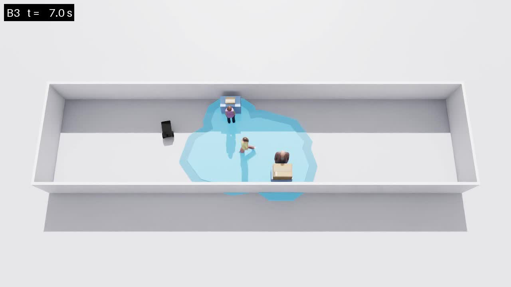
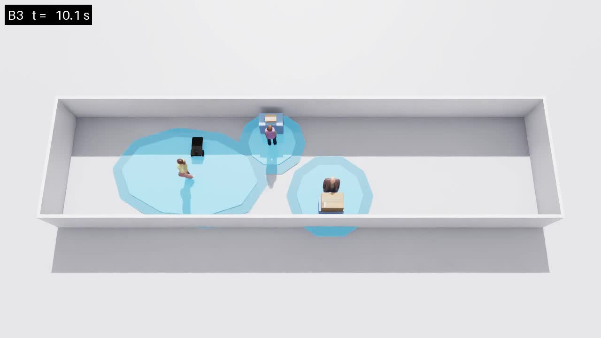

# Comfort_AMR 구현 정리

> Human State 기반 Comfort Space를 활용한 인간-로봇 공유 작업공간의 AMR 교착 해소 및 디지털 트윈 검증

**요약**: 좁은 복도에서 사람의 상태를 무시한 고정 Comfort Space(B2)는 교착을 만들고, 상태에 따라 크기를 바꾸는 Comfort Space(B3)는 사람 공간을 침범하지 않고 통과한다. 두 시나리오는 Comfort Space 정책 하나만 다르다.

---

## 1. 비교 설계

| | B2 Static | B3 Human State-Adaptive |
|---|---|---|
| Comfort Space | 모든 사람 1.20 m | 상태별 0.60 / 0.90 / 1.20 m |
| 나머지 조건 | 동일 | 동일 |
| 결과 | **교착 (DEADLOCK)** | **성공 (SUCCESS)** |

공유 조건: 복도, Station, 사람 위치, AMR, Nav2 파라미터, 판정 기준. 시나리오 설정 파일에는 Comfort Space 정책 외 항목을 넣을 수 없게 막아두었다.

---

## 2. 시스템 구성

- **Comfort Space는 벽이 아니다**: costmap에 치명 비용(100)이 아닌 높은 유한 비용(98)으로 넣는다. 통과할 수는 있지만 비싼 영역이다.
- **통과 여부 결정은 게이트가 한다**: Nav2 명령이 Comfort Space를 침범하려 하면 게이트가 멈춘다. 비용 모델과 양보 정책을 분리했다.
- **사람 상태 인식은 인터페이스 뒤에 있다**: 지금은 설정값을 그대로 쓰는 Ground Truth 방식이고, 센서 기반으로 교체할 수 있게 분리했다.

---

## 3. 환경

| 항목 | 값 |
|---|---|
| 복도 | 12 m × 3.9 m (걷는 사람 데모는 16 m) |
| Station | 0.8 × 0.45 × 0.9 m, 양쪽 벽에 하나씩 엇갈려 배치 |
| 사람 a | Station A 앞, 작업 중 (station_engaged) |
| 사람 b | Station B 옆, 서 있음 (stationary) |
| 사람 c | 복도 끝에서 출발해 반대편까지 한 번 걷고 정지 (데모 전용) |
| AMR | 0.70 × 0.48 m, 최대 0.4 m/s |
| 출발 → 목표 | (-5, 0) → (5, 0) |

---

## 4. Comfort Space 정책

| 상태 | B2 | B3 |
|---|---|---|
| 작업 중 | 1.20 m | 0.60 m |
| 서 있음 | 1.20 m | 0.90 m |
| 걷는 중 | 1.20 m | 0.90 → 1.20 m, 속도에 비례 |

- **걷는 사람**: 진행 방향으로 최대 1.8배 늘어난 타원이다. 멈추면 서 있는 사람 크기로 줄어든다.
- **반지름 정의**: 사람 중심에서 로봇 몸체 가장 가까운 부분까지의 거리다. Nav2에는 로봇 폭 절반을 더해 전달한다.
- **수치 성격**: 프로토타입 검증용 엔지니어링 값이다. 실험으로 검증된 사람의 편안한 거리가 아니다.

---

## 5. 양보와 비켜서기

| 상대 | 로봇 동작 |
|---|---|
| 서 있는 사람 | Comfort Space 경계에서 멈춰 기다린다 |
| 걸어오는 사람 | 도착 6초 전에 진행선 옆으로 비켜서고, 지나가면 다시 출발한다 |

**걷는 사람에게 멈춤이 안 되는 이유**: 걷는 사람은 로봇을 피하지 않고 직진한다. B2와 B3에서 사람 움직임이 같아야 비교가 성립하기 때문이다. 그래서 진행선 위에서 멈추면 그대로 부딪힌다.

| 걷는 사람과 최소 틈 | 값 |
|---|---|
| 기존 (멈춤) | **-0.058 m, 1.0초 충돌** |
| 비켜서기 적용 | **+0.380 m, 충돌 없음** |

비킬 위치는 사람이 다가오는 동안 계속 다시 계산한다. 사람 속도와 방향은 1초 구간 평균으로 추정한다. 걸을 때 몸이 흔들려 방향 추정이 틀어지는 문제 때문이다. 오프라인 테스트 432회에서 충돌이 없었다.

---

## 6. 결과

| 시나리오 | 결과 | 주행 시간 | 양보 시간 | 걷는 사람과 최소 틈 |
|---|---|---|---|---|
| B2 | 교착 | 27.5 s | 11.6 s | - |
| B3 | 성공 | 26.7 s | 0 s | - |
| B2 + 걷는 사람 | 교착 | 35.3 s | 18.6 s | +0.365 m |
| B3 + 걷는 사람 | 성공 | 35.9 s | 8.4 s | +0.380 m |

모든 시간은 시뮬레이션 시간이다. 네 경우 모두 Collision Monitor 개입은 0초였다. 교착은 안전 정지가 아니라 Comfort Space 양보 때문에 생겼다는 뜻이다.

### B2 · 교착
두 Comfort Space가 좁은 구간을 막아 로봇이 사이에서 기다린다.

> 📹 영상: `results/videos/b2_static/standing_only/20260915_2004_camera.mp4`

### B3 · 통과
작업 중인 사람 a의 공간이 줄어 통로가 열리고, 침범 없이 지나간다.

> 📹 영상: `results/videos/b3_state_adaptive/standing_only/20260915_2006_camera.mp4`

### B3 + 걷는 사람 · 비켜서기
걸어오는 사람을 보고 진행선 옆으로 미리 비켜선다.

사람이 지나가는 순간에도 몸체가 겹치지 않는다.

> 📹 영상: `results/videos/b3_state_adaptive/with_walker/20260915_2010_camera.mp4`
> 📹 영상: `results/videos/b2_static/with_walker/20260915_2008_camera.mp4`

---

## 7. 판정 기준

| 결과 | 조건 |
|---|---|
| PLANNING_FAILURE | 출발 전 경로 계산 실패 |
| SUCCESS | 목표 0.25 m 이내 도달 |
| DEADLOCK | 12초 동안 목표 쪽으로 0.15 m 이상 못 나감 |
| TIMEOUT | 120초 초과 |

사람이 걷고 있는 동안 기다리는 시간은 교착으로 세지 않는다.

---

## 8. 한계와 다음 단계

**한계**
- Comfort Space 반지름이 실험 근거 없는 엔지니어링 값이다.
- 걷는 사람은 로봇에 반응하지 않는 직진 보행자 1명이다. 실제 사람보다 가혹한 조건이다.
- Nav2는 벽시계 시간으로 돌아서, 녹화처럼 렌더링 부담이 늘면 경로가 조금 달라진다. 논문 수치는 녹화 없는 실행에서 뽑는다.
- 영상에서 사람 b도 Station을 보고 서 있어 작업 중처럼 보이지만, 상태는 서 있음이다.

**다음 단계**
- 결과 CSV 기록과 반복 실행 스크립트
- 걷는 사람 예측 진행 영역을 Comfort Space 비용에 반영
- 사람 상태를 센서 기반으로 추정하는 인터페이스 구현
